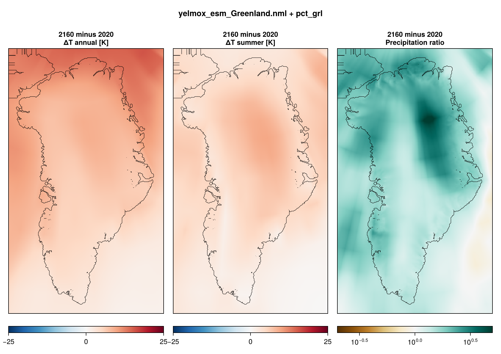
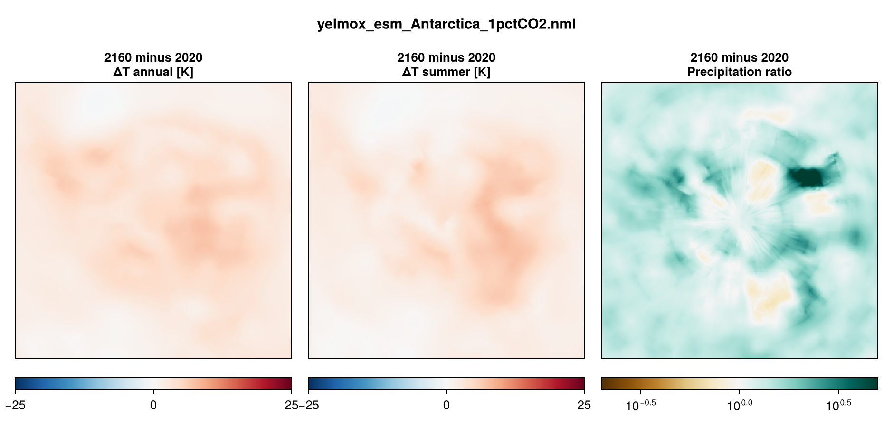

Greenland and Antarctic simulations under the idealized CMIP experiment 1pctCO2
(atmospheric CO2 rising by 1 %/yr, about 4xCO2 after 140 yr), in two steps: a
present-day **optimization spin-up**, as for [ISMIP7](experiment-ismip7.md),
then the **scenario**, which starts from the spin-up's restart bundle and runs
140 yr under the absolute CMIP fields of one GCM, taken relative to their own
first years.

- **Program:** `yelmox` (`make yelmox`) with the ESM climate backend
  (`[comps] climate = "esm"`, see [ESM forcing](climate-esm.md)).
- **Config:** `yelmox/yelmox_esm_Greenland.nml`, `yelmox/yelmox_esm_Antarctica.nml`
  (the 1pctCO2 setup: `-p`).
- **Forcing data:** `input/esm/esm_grl_1pctCO2.nml`, `input/esm/esm_ant_1pctCO2.nml`
  (see [Database namelists](database-namelists.md)).
- **Scripts:** `scripts/1pctCO2/` -- workflows `run_1pctco2_greenland.sh`,
  `run_1pctco2_antarctica.sh`; tuned Antarctic spin-up `opt_ant.sh`. The setup is
  `scripts/1pctCO2/params.sh` (`pct_grl`; Antarctica `pct_ant` after `ismip7_ant`
  of `scripts/ismip7/params.sh`).

## Running

Run from the yelmox root, one step after the other: the scenario reads the
spin-up's last restart bundle.

```bash
scripts/1pctCO2/run_1pctco2_greenland.sh spinup
```

```bash
scripts/1pctCO2/run_1pctco2_greenland.sh scenarios
```

`GCM=<name>` selects the GCM of the scenario (default `MPI-ESM1-2-LR`; the
script lists `NorESM2-MM`, `UKESM1-0-LL`, `IPSL-CM6A-LR`, `CESM2`); the spin-up
does not depend on it. `STAGE=1` creates the run folders and the SLURM script
without submitting them. The settings are at the top of each script:

| Setting | Greenland | Antarctica | |
|---|---|---|---|
| `GRID` | `GRL-8KM` | `ANT-32KM` | `[domain] grid_hub` |
| `SPINUP_YEARS` | 15000 | 20000 | `[spinup] time_end`, matches `[opt] cf/tf_time_end` |
| `PROJ_INIT`, `PROJ_END` | 2020, 2160 | 2020, 2160 | `[transient] time_init`, `time_end` |
| `OUTROOT` | `output/1pctco2_grl` | `output/1pctco2_ant` | spin-up in `spinup/`, scenario in `1pctCO2_<GCM>/` |

The Antarctic Earth structure is that of the isostasy grid (`[isos]
rheology_file = ".../{grid_name}_GIA_HR24.nc"`, `{grid_name}` = `grid_isos`).

## Spin-up

The spin-up passes `ctrl.run_step=spinup comps.dt_clim=10 sim.relax=True
sim.opt=True esm.experiment=ctrl`. It is the ISMIP7 spin-up (same `[spinup]`,
`[relax]` and `[opt]` groups) except for the surface mass balance, which chion
computes from the reference climate (`[comps] surface_method = "chion"`; ISMIP7
takes the ESM's own smb). In the spin-up the backend applies the reference
climatology only.

`opt_ant.sh` is a tuned 20-kyr Antarctic optimization spin-up on ANT-16KM with
`yelmox_esm_Antarctica.nml`, `ismip7_ant` and `pct_ant`: `cb_ref` started from
the till friction of the bed (`opt.cf_init=-1`), a short relaxation
(`relax.time1/2 = 100`), the
ocean extrapolated into the shelves (`marine_shelf.extrap_shlf=True`),
equilibrium calving, DIVA, shelf enhancement 0.5. Output in
`output/1pctCO2/opt-ANT-16KM-l21-bedmap3`.

## Scenario

- **Timeline:** `[transient]` 2020 to 2160 on the calendar clock (`[ctrl]
  calendar = True`, `tstep_method = "cal"`, `dtt = 1` yr): the start of the
  experiment (about 1xCO2) is 2020, the end 140 yr later.
- **Switches:** `ctrl.run_step=transient esm.experiment=1pctCO2
  esm.esm_name=<GCM> esm.use_esm=True esm.use_hist=False esm.use_proj=True`,
  `ctrl.restart` = `<OUTROOT>/spinup/restart-<SPINUP_YEARS/1e3>-kyr` (absolute path).
- **Periods:** `time_esm_ref = 2020, 2021`, `time_proj = 2020, 2160`;
  `time_hist = 2018, 2019` lies before `time_init`, so every step reads the
  projection.

## Forcing

The CMIP files hold absolute fields. The `gcm_*_esm_ref` and `gcm_*_proj`
groups point at the same file, so the anomalies are taken against the mean of
the experiment's first two years (`time_esm_ref`): `dts = tas(t) - tas_ref`
(monthly), `dpr = pr(t) / pr_ref`, and the ocean temperature and salinity
anomalies (annual) interpolated to the shelf base. They are added to the
reference climatology of each domain.

| | Greenland | Antarctica |
|---|---|---|
| Reference atmosphere | MAR v3.14, monthly climatology 1961--1990 (`time_ref`), FesmData v2 `SMB-MARv3.14-1961-1990` | RACMO2.3p2 (ERA5-3H), monthly 1979--2022, averaged over 1985--2014 (`time_ref`) |
| Reference ocean | ORAS5, 1981--2010, read on GRL-16KM and remapped (`bilin`, gaps filled) | meltMIP observational climatology (extrapolated), as ISMIP7 |
| ESM files | `ice_data/1pctCO2/Global/{gcm}/<var>/{gcm}_1pctCO2_*_<var>.nc`, years 2020--2169 | same |
| ESM atmosphere | `tas`, `pr` (monthly), remapped online from the GCM grid (`bilinear`, `grid_src = "{gcm}-atm"`) | same |
| ESM ocean | `thetao`, `so` (annual), remapped online (`shepard`, `grid_src = "{gcm}-ocn"`) | same |
| Subglacial discharge | none (`[gcm_sgd_proj] filename = "none"`, `Qd = 0`) | -- |
| Surface mass balance | chion | chion |
| Shelf melt | `bmb_method = "anom"`, `tf_method = 2` | `bmb_method = "quad-nl"`, `tf_method = 1` |

`[esm] dT_threshold`, `f_ocn` and `f_polar` act only on the homogeneous
anomaly of `use_esm = False` (see [ESM forcing](climate-esm.md)); the gridded
forcing does not use them.





## Output

The shared per-module files (`yelmo.nc`, `yelmo_ts.nc`, `isos.nc`, `mshlf.nc`,
`chion.nc`, `htopo.nc`; Antarctica also `yelmo_ts_APIS/WAIS/EAIS.nc`) and the
restart bundles `restart-<kyr>-kyr/`. With the par-file timing, the scenario
writes the 1D output every year, the 2D output (`[tm_2D]`) and restart bundles
at 2020 and 2160. `[output] write_clim = True` adds `esm.nc` and `esm_ts.nc`.
