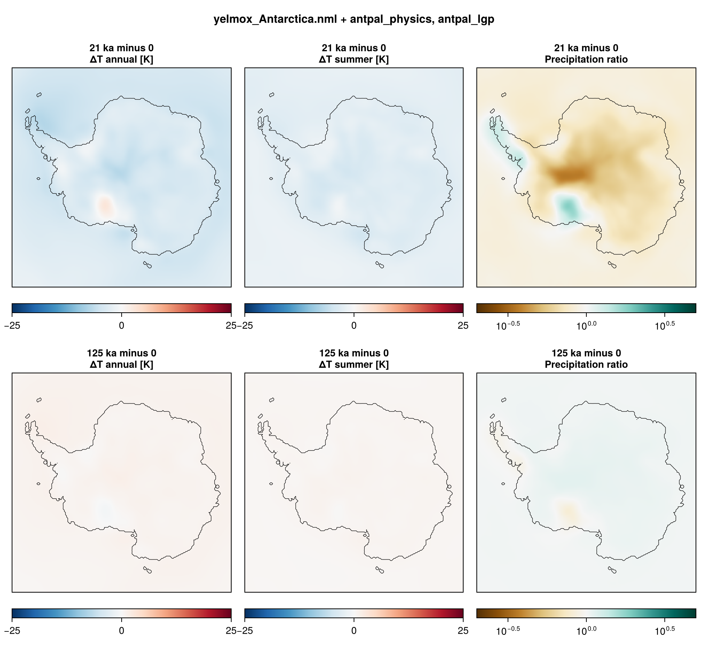

An Antarctic simulation of the last glacial period at 32 km, in two steps: a
15-kyr present-day **spin-up** that optimizes the basal friction (`cb_ref`) and the
ocean thermal-forcing correction (`tf_corr`), then a **transient** from 130 kyr
ago to 10 kyr in the future, restarted from the spin-up, with the climate scaled
by a glacial index and the sea level following a reconstruction.

- **Program:** `yelmox` (`make yelmox`) with the snapshot backend
  (`[comps] climate = "snapshots"`, see [Snapshots](climate-snapshots.md)).
- **Config:** `yelmox/yelmox_Antarctica.nml` (base).
- **Scripts:** `scripts/ant-paleo/run_spinup.sh`, `scripts/ant-paleo/run_lgp.sh`.
  The 32 km setup and the forcing are set with `-p`:
  `scripts/ant-paleo/params.sh` (`antpal_physics`, `antpal_lgp`). Ported from
  the old single-grid par files.

## Running

Run from the yelmox root; the transient needs the spin-up's last restart bundle.

```bash
scripts/ant-paleo/run_spinup.sh
```

```bash
scripts/ant-paleo/run_lgp.sh
```

`run_spinup.sh [output_path]` writes to `output/ant-paleo/spinup` by default.
`run_lgp.sh [spinup_path] [output_path]` restarts from
`<spinup_path>/restart-15.000-kyr` (passed as an absolute path; the script stops if
the bundle is missing) and writes to `output/ant-paleo/lgp`. Both submit to the
`shared` queue (2 days, 10 GB, no OpenMP).

## Spin-up

- **Timeline:** `[ctrl]` 0 to 15 kyr, `dtt = 5` yr, present-day insolation
  (`[orbit] method = "time"`, `time = 0`); the
  sea level follows the model's own ice-volume change (`[barysealevel] method =
  "fastiso"`).
- **Optimization** (`[sim] opt = True`): `cb_ref` (`[opt] opt_cf = "L21"`)
  and `tf_corr` per point (`opt_tf = "L21-points"`) until 7.5 kyr
  (`cf_time_end`, `tf_time_end`), starting from the till friction of the bed
  (`cf_init = -1`); the ice relaxes towards the observations at the grounding
  line and grounding zone (`[relax] topo_rel = 4`) until 3 kyr (`[sim] relax =
  True`, `[relax] time2`).
- **Climate:** present day (`forcing.coefs==dTo`, `forcing.terms==ocean`);
  the term `ocean` (`coef_dTo.factor=0.40`) is active but sees no anomaly
  (the sea-level air temperature is the reference's).
- **Output:** restart bundles every 15 kyr, so `restart-0.000-kyr` and
  `restart-15.000-kyr`; 2D output every 5 kyr, 1D every 100 yr.

## Transient

- **Timeline:** `[ctrl]` -130 kyr to +10 kyr, `dtt = 5` yr, on relative time
  (`tstep_method = "rel"`), so that the sea level and `alpha` follow the
  records. `[sim] relax = False`, `opt = False`: `cb_ref` and `tf_corr` come
  from the restart.
- **Climate:** the present-day reference plus the term `lgm`
  (`[term_lgm]`, `picontrol` -> `lgm` on `tas` and `pr`): the PMIP3 LGM --
  piControl anomaly of the air temperature and ratio of the precipitation,
  scaled by the coefficient `alpha` (`[coef_alpha]`, `method = "series"`,
  `input/alpha_combined_125kyr_interp.dat`, as is: 0 = present day, 0.92 at
  21 ka, -0.2 in the last interglacial). The term `ocean` adds the derived
  coefficient `dTo`, 0.25 times the mean sea-level air temperature anomaly.
  Insolation varies in time (`[orbit] method = "forcing_time"`, the orbit at
  the forcing time, for chion and smbpal).
- **Sea level:** `[barysealevel] method = "file"`, `input/sealevel_rohling_450kyr.dat`.
- **Ice age:** isochrones with elsa (`[ytrc] use_elsa`, `[elsa_ant_paleo]`): one
  layer every 1 kyr, coupled every 50 yr.
- **Output:** 2D every 1 kyr, 1D every 100 yr, restart bundles every 25 kyr.



## Configuration common to both

| | |
|---|---|
| Grids | `ANT-32KM` for every component (single-grid setup) |
| Topography | BedMachine v4 (`[topo]`, FesmData `ANT-32KM_TOPO-BedMachine-v4.nc`) |
| Reference climate (`snapshot_pd`) | RACMO2.3p2 1981--2010, monthly (2 m air temperature, precipitation, surface elevation; FesmData `SMB-RACMO2.3p2-1981-2010`); ocean ISMIP7 climatology (FesmData `Ocean-ISMIP7`) |
| Snapshots (`snapshot_picontrol`, `snapshot_lgm`) | PMIP3 piControl and LGM ensemble means, global (`GLOBAL-1DEG`, remapped, 50 km smoothing; annual mean and DJF air temperature, annual precipitation; atmosphere only, the ocean follows the term `ocean`) |
| Surface mass balance | chion ITM (`[comps] surface_method = "chion"`) |
| Shelf melt | `bmb_method = "quad-nl"`, `tf_method = 1` |
| Calving | `calv_flt_method = "vm-m16"` |
| Dynamics | DIVA |
| Isostasy | FastIsostasy LV-ELVA (`[isos] method = 3`), Earth structure `ANT-32KM_GIA_HR24.nc` (`{grid_name}_GIA_HR24.nc` of the isostasy grid; mantle viscosity + lithosphere), `[comps] dt_isos = 10` yr |
| Climate update | `[comps] dt_clim = 10` yr |
| Named regions | `[regions] masks = "APIS" "WAIS" "EAIS"`: `yelmo_ts_APIS.nc`, `yelmo_ts_WAIS.nc`, `yelmo_ts_EAIS.nc` |
