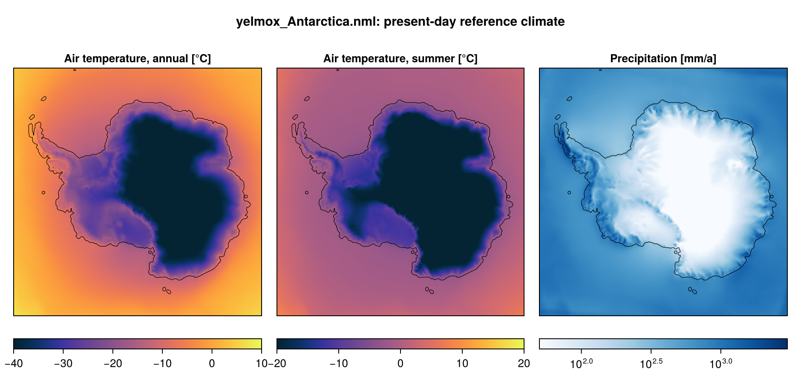

Antarctic test cases in the present-day climate (RACMO2.3p2 1981--2010, ISMIP7
ocean) with the snapshot backend: a 15-kyr **spin-up** at 32 km that optimizes
the basal friction (`cb_ref`) and the ocean thermal-forcing correction
(`tf_corr`), with the marine shelf on a 16 km grid (`yelmox_Antarctica.nml`, the
base of a multigrid resolution test), and a 50-kyr **present-day** run at 32 km
without optimization (the same par file with `-p` overrides). Two variants run
on the ESM backend (`yelmox_esm_Antarctica.nml`,
`yelmox_esm_Antarctica_nudge.nml`).

- **Program:** `yelmox` (`make yelmox`) with the snapshot backend
  (`[comps] climate = "snapshots"`, see [Snapshots](climate-snapshots.md)); the
  ESM variants with `[comps] climate = "esm"` (see [ESM forcing](climate-esm.md)).
- **Config:** `yelmox/yelmox_Antarctica.nml` (the present-day run: `-p`, see
  Running), `yelmox/yelmox_esm_Antarctica.nml`,
  `yelmox/yelmox_esm_Antarctica_nudge.nml`.
- **Scripts:** `yelmox/run_mg_resolution.sh`, `yelmox/run_mg_cfmin.sh`,
  `yelmox/run_mg_forward.sh`, all on `yelmox_Antarctica.nml`.

## Running

From the yelmox root:

```bash
runme -rs -q compute -w 02:00:00 --omp 16 -e yelmox -n yelmox/yelmox_Antarctica.nml -o output/ant
```

```bash
runme -rs -q compute -w 08:00:00 --omp 16 -e yelmox -n yelmox/yelmox_Antarctica.nml -o output/ant-pd \
      -p ctrl.time_end=50e3 sim.relax=False sim.opt=False domain.grid_hub=ANT-32KM domain.grid_ice="" \
         domain.grid_shelf=ANT-32KM marine_shelf.tf_correction=True tm_2D.dt=500 tm_2Dsm.dt=500
```

On a busy queue, run them as chains of short jobs ([Long runs in
chunks](run-chunks.md)). The multigrid resolution test, from anywhere; `run_mg_forward.sh` needs the
restart bundles of `run_mg_resolution.sh`:

```bash
yelmox/run_mg_resolution.sh
```

```bash
yelmox/run_mg_cfmin.sh
```

```bash
yelmox/run_mg_forward.sh
```

The scripts submit by default (`runopts=-r` runs locally, `runopts=-s` stages
only). The climate always runs on `ANT-32KM`; Yelmo, isostasy and the surface on
the Yelmo grid; the hub and the marine shelf on the shelf grid.

- **`run_mg_resolution.sh`:** six 25-kyr spin-ups (`ctrl.time_end=25e3`) into
  `output/mg_opt/y<ice>_m<shelf>`: Yelmo and shelf on the same grid (`ANT-8KM`,
  `ANT-16KM`, `ANT-32KM`), and the shelf on a finer grid (Yelmo 32 km with shelf
  8 or 16 km, Yelmo 16 km with shelf 8 km). 2D output every 1 kyr,
  `ytopo.gz_Hg1=100`; `shared` queue, 10 h.
- **`run_mg_cfmin.sh`:** the three Yelmo-32KM spin-ups again with the friction
  floor `ytill.cf_min=1e-4` (par file: 0.01), into `output/mg_opt_cfmin1e-4`;
  `compute` queue, 8 h.
- **`run_mg_forward.sh`:** 1-kyr runs from `restart-25.000-kyr` of the three
  Yelmo-32KM spin-ups in `output/mg_opt` (a missing bundle is skipped), with
  `sim.relax=False`, `sim.opt=False`, `yelmo.restart_relax=0`: `ctrl` (no
  anomaly) and `warm` (+2 K air and ocean temperature: `[anom]` on the constant
  index `[idx_dT]`, `f_ta = 1`, `f_to = 1`), into `output/mg_fwd/<case>_<ctrl|warm>`;
  `compute` queue, 4 h.

## Spin-up

- **Timeline:** `[ctrl]` 0 to 15 kyr, `dtt = 10` yr, the forcing held at
  present day (`tstep_method = "const"`, `tstep_const = 0`), present-day
  insolation (`[orbit] method = "time"`, `time = 0`); the sea level follows the
  model's own ice-volume change (`[barysealevel] method = "fastiso"`).
- **Cold start:** a 10-yr equilibration (`[sim] init_method = "equil"`,
  `init_equil_time = 10`).
- **Optimization** (`[sim] opt = True`): `cb_ref` (`opt_cf = "L21"`, from
  `cf_init = 1e-2` everywhere) and `tf_corr` per point (`opt_tf = "L21-points"`,
  `tf_sigma = 50` km, within ±1 K), both until 15 kyr (`[opt] cf_time_end`,
  `tf_time_end`); the grounding line and grounding zone relax towards the
  observations until 6 kyr (`[sim] relax = True`, `[relax] topo_rel = 4`,
  `tau1 = 100` yr until 2 kyr, then towards `tau2 = 2000` yr).
- **Basin corrections:** `[marine_shelf] corr_method = "tf"`, `corr_names =
  "b1" "b12" "b14" "b15"`, `corr_values = 0.3 0.3 -1.5 0.0` on the
  `Zwally2012` basins 1 (Ronne), 12 (Ross), 14 (Pine Island) and 15 (Abbott);
  `corr_b<k>` selects basin k.
- **Output:** 1D every year, 2D every 200 yr, small 2D every 50 yr.

## Climate

Present day only (`[snap] snapshots = "pd"`), without indices (`[indices]
names = ""`), `[anom]` or `[ocn_fraction]`. `[idx_dT]` (`method = "const"`, 0)
serves `run_mg_forward.sh`, which sets it with `idx_dT.f_min = f_max`.



## Present day

0 to 50 kyr, no relaxation, no optimization (`[sim] relax = False`,
`opt = False`), every component on `ANT-32KM`. `tf_corr`
is read from a file (`[marine_shelf] tf_correction = True`: `dT_nl` of
`{grid_name}_OCEAN_ISMIP6_J20.nc`). 2D and small 2D output every 500 yr.

## ESM variants

Two phases in calendar years (`[ctrl] calendar = True`, `calendar_ref = 2000`):
`[spinup]` (the par files' `run_step`), 0 to 20 kyr with the forcing held at
2020 (`tstep_const`) and the reference climatology only, `cb_ref` and `tf_corr`
optimized until 20 kyr; and `[transient]`, on calendar time with `dtt = 1` yr. Both read the reference RACMO2.3p2 (ERA5-forced,
1990--2019, detrended) and ORAS5 1990--2019 (detrended), with `[esm] experiment
= "ctrl"`.

| | `yelmox_esm_Antarctica.nml` | `yelmox_esm_Antarctica_nudge.nml` |
|---|---|---|
| Grids | `ANT-8KM` for every component | `ANT-16KM` for every component |
| `[esm] par_file` | `input/esm/esm_ant.nml` (ISMIP6-2300) | `input/esm/esm_nudge.nml` (`Nudge_Skiba26`, years 4501--5000) |
| `[esm] use_esm` | `False` | `True` |
| `[transient]` | 1020 to 3500 | 4501 to 5000 |
| Surface mass balance | chion ITM (`nml_itm = "itm"`) | chion PDD (`[pdd_chion]`, `cg05`) |
| `[esm] experiment` | `"ctrl"` | `"ctrl"` (reference only) or `"nudgedhigh03"` with `use_proj = True`: the anomaly of the nudged AWI-ESM run minus its PI run, 3501--5000 (atmosphere; the ocean has no nudged files on ANT-16KM yet) |

The reference climate is the mean over `time_ref` (1990--2019) of the RACMO2.3p2
1979--2022 and ORAS5 1979--2024 monthly series. On ANT-8KM the ORAS5 reference
needs about 15 GB: run with `--omp 32` or more (the memory follows the cores).

## Configuration

| | |
|---|---|
| Grids | hub and marine shelf `ANT-16KM`; Yelmo, isostasy, climate and surface `ANT-32KM` (pd: `ANT-32KM` for every component) |
| Topography | BedMachine v4 (`{grid_name}_TOPO-BedMachine-v4.nc`) |
| Reference climate (`snap_pd`) | RACMO2.3p2 1981--2010 (temperature, precipitation, elevation); ocean ISMIP7 climatology (FesmData `Ocean-ISMIP7`) |
| Surface mass balance | chion PDD (`[chion] model = "pdd"`, `[pdd_chion] pdd_method = "cg05"`, `temperature_sigma = 5` K) |
| Shelf melt | `bmb_method = "quad-nl"`, `tf_method = 1`; grounding-line melt `[ytopo] bmb_gl_method = "pmpt"` |
| Calving | `calv_flt_method = calv_grnd_method = "equil"` (level set, calving rate opposite to the ice velocity) |
| Dynamics | DIVA, regularized Coulomb friction (`beta_method = 3`), `beta_gl_scale = 2` (Zstar) |
| Isostasy | FastIsostasy LV-ELVA (`method = 3`), Earth structure of the isostasy grid (`[isos] rheology_file = ".../{grid_name}_GIA_HR24.nc"`: `ANT-32KM_GIA_HR24.nc`) |
| Geothermal heat flux | `{grid_name}_GHF-Shapiro2004.nc` |
| Present-day data | RACMO2.3/ERA-Interim hybrid 1981--2010 smb and surface temperature, velocity `Rignot2011` (`[yelmo_data]`) |
| Named regions | `yelmo_ts_APIS/WAIS/EAIS.nc` |
