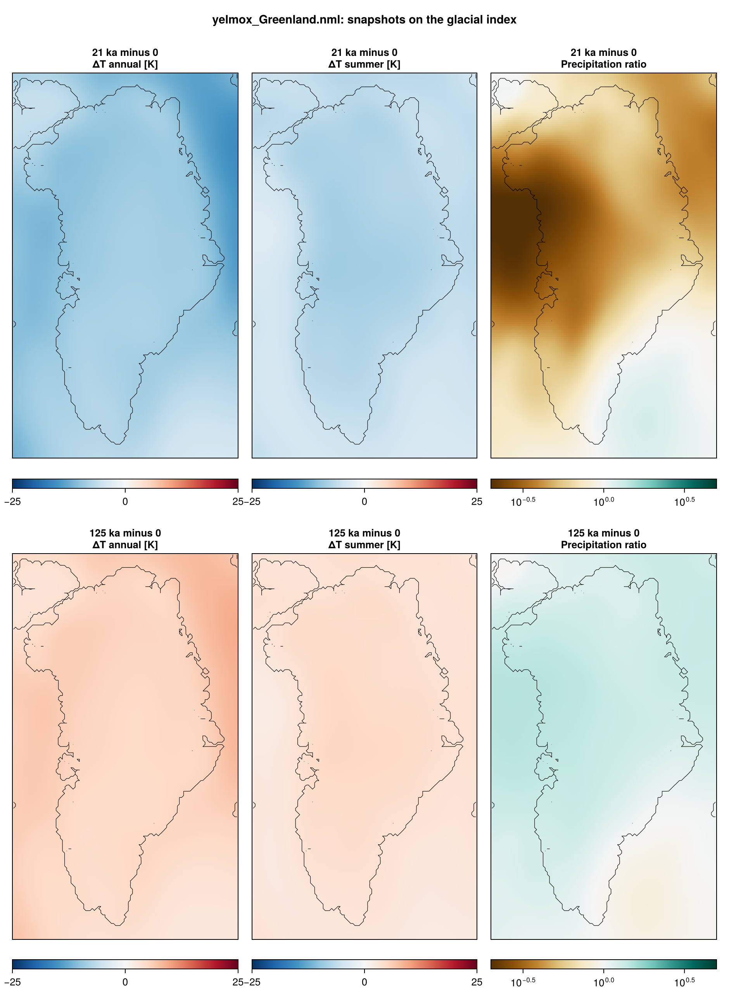
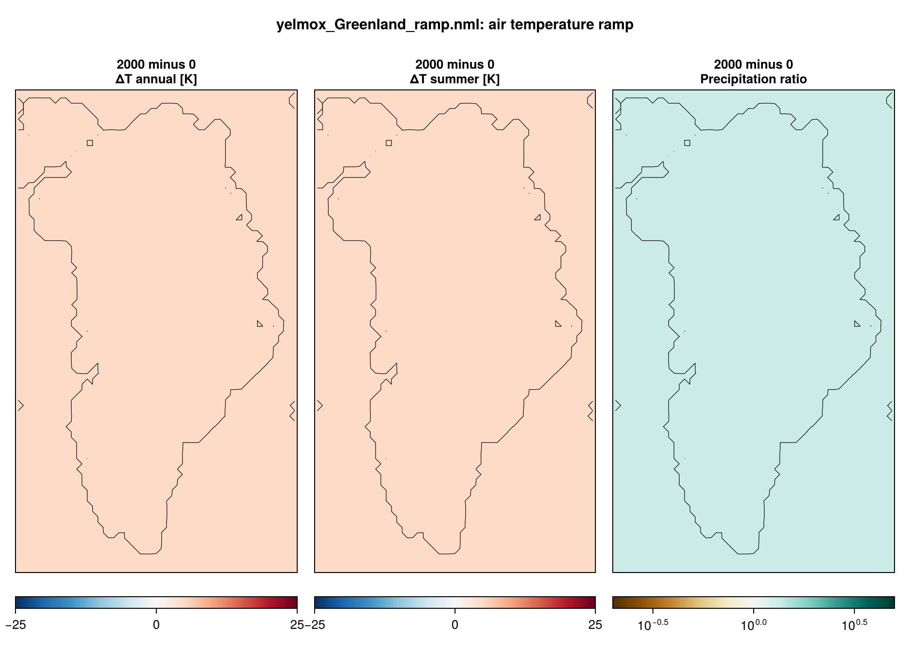

Greenland test cases at 16 km, without optimization of the basal friction or the
ocean thermal forcing: the present-day reference climate with the PMIP3
piControl and LGM snapshots on a glacial index axis `at`
(`yelmox_Greenland.nml`), the same with a homogeneous air temperature ramp as a
functionality test at 32 km (`yelmox_Greenland_ramp.nml`), and the present-day
reference alone (`yelmox_pd_Greenland.nml`).

- **Program:** `yelmox` (`make yelmox`) with the snapshot backend
  (`[comps] climate = "snapshots"`, see [Snapshots](climate-snapshots.md)).
- **Config:** `yelmox/yelmox_Greenland.nml`, `yelmox/yelmox_Greenland_ramp.nml`,
  `yelmox/yelmox_pd_Greenland.nml`.

## Running

Run from the yelmox root:

```bash
runme -rs -q compute -w 02:00:00 --omp 16 -e yelmox -n yelmox/yelmox_Greenland.nml -o output/grl
```

```bash
runme -rs -q compute -w 02:00:00 --omp 16 -e yelmox -n yelmox/yelmox_Greenland_ramp.nml -o output/grl-ramp
```

```bash
runme -rs -q compute -w 08:00:00 --omp 16 -e yelmox -n yelmox/yelmox_pd_Greenland.nml -o output/grl-pd
```

On a busy queue, run them as chains of short jobs ([Long runs in
chunks](run-chunks.md)). The forcing time of `yelmox_Greenland.nml` is set with `-p`: e.g.
`ctrl.tstep_const=-21e3` holds the climate of 21 ka, `ctrl.tstep_method=rel
ctrl.time_init=-130e3 ctrl.time_end=0` follows the index through the last
glacial cycle.

## Timeline

- **`yelmox_Greenland.nml`:** `[ctrl]` 0 to 15 kyr, `dtt = 10` yr, the forcing
  held at present day (`tstep_method = "const"`, `tstep_const = 0`), where
  `at = 0`: the climate is the present-day reference.
- **`yelmox_Greenland_ramp.nml`:** the same on relative time
  (`tstep_method = "rel"`), so that the ramp advances with the model time.
- **`yelmox_pd_Greenland.nml`:** 0 to 50 kyr.
- **All:** cold start on the present-day topography (`[sim] init_method =
  "none"`), no relaxation, no optimization (`[sim] relax = False`, `opt =
  False`; `[relax]` and `[opt]` are unused). Present-day insolation (`[orbit]
  method = "time"`, `time = 0`); the sea level follows the model's own
  ice-volume change (`[barysealevel] method = "fastiso"`).
- **Output:** 1D every year; 2D every 200 yr (ramp: 50 yr; pd: 500 yr), small
  2D every 50 yr (pd: 500 yr).

## Climate: snapshots on a glacial index

Snapshots `pd`, `picontrol`, `lgm` and the axis `at` (`[snap_axis_at]`,
`picontrol` -> `lgm`). The temperature adds the PMIP3 LGM -- piControl anomaly
scaled by `at` (`[snap_field_tas] axes = "at"`), the precipitation is
multiplied by their ratio (`[snap_field_pr] blend = "ratio"`). The PMIP3
snapshots give the annual mean and JJA temperature (`monthly = False`) and the
annual precipitation, smoothed over 50 km at loading (`clim_sigma = 50`). The
precipitation-temperature scaling is `[snap] f_p = 0.06` (default 0.05).

The index `[idx_at]` is the orbital series `input/alpha_orbital_r2020.dat`
(`method = "series"`, 300 ka to present), normalised to 0 at present
(`norm_t0 = 0`) and 1 at 21 ka (`norm_t1 = -21e3`). The ocean (ORAS5) has no
axis: its anomaly is `f_to = 0.25` times the mean sea-level air temperature
anomaly over the domain (`[ocn_fraction]`, `region = "all"`).



## Air temperature ramp

`yelmox_Greenland_ramp.nml` adds the index `ramp` (`[indices] names = "at"
"ramp"`) and applies it as a homogeneous anomaly (`[anom] active = True`,
`index = "ramp"`, `f_ta = 1`, `f_to = 0`, `f_so = 0`):

- **Index:** `[idx_ramp] method = "ramp-slope"`, `df_dt_max = 0.0025` yr⁻¹
  from `f_min = 0` to `f_max = 5`: the air temperature rises by 5 K over
  2000 yr and stays there; white noise of `sigma = 0.3` on the index;
  `with_kill = False`.
- **Response:** the precipitation is multiplied by exp(`f_p`·dTa); the ocean
  follows through `[ocn_fraction]`, whose sea-level anomaly includes dTa.



## Present day

`yelmox_pd_Greenland.nml` keeps the reference only (`[snap] snapshots =
"pd"`), without indices (`[indices] names = ""`) and with `[ocn_fraction]
active = False`. Its basin sets are `Zwally2012` only (no `NEGIS`).

## Configuration

| | |
|---|---|
| Grids | `GRL-16KM` for every component (`yelmox_Greenland_ramp.nml`: `GRL-32KM`) |
| Topography | BedMachine v6 (`{grid_name}_TOPO-BedMachine-v6.nc`) |
| Ice domain | `[yelmo_masks] mask_ice_dynamic = "region:Greenland,Canadian_Arctic_Archipelago"` |
| Reference climate (`snap_pd`) | MAR v3.14 1961--1990 (temperature, snowfall + rainfall, elevation); ocean ORAS5 1981--2010 |
| Snapshots (`snap_picontrol`, `snap_lgm`) | PMIP3 piControl and LGM ensemble means, global (`GLOBAL-1DEG`, remapped, 50 km smoothing; atmosphere only, the ocean follows `[ocn_fraction]`) |
| Surface mass balance | chion ITM (`[comps] surface_method = "chion"`, `[chion] nml_itm = "itm_chion"`, `alb_ice = 0.31`) |
| Shelf melt | `bmb_method = "lin"`, `tf_method = 1` |
| Calving | `calv_flt_method = calv_grnd_method = "equil"` (level set, calving rate opposite to the ice velocity) |
| Dynamics | DIVA, regularized Coulomb friction (`beta_method = 3`, `beta_q = 0.2`, `beta_u0 = 100` m/yr) |
| Isostasy | FastIsostasy LV-ELRA (`method = 2`), uniform mantle (10²¹ Pa s, `tau = 3000` yr) |
| Geothermal heat flux | constant 50 mW m⁻² (`[ghf] use_obs = False`) |
| Present-day data | MAR v3.14 1961--1990 smb and surface temperature, velocity `Joughin2018`, isochrones `MacGregor2025` (`[yelmo_data]`) |
