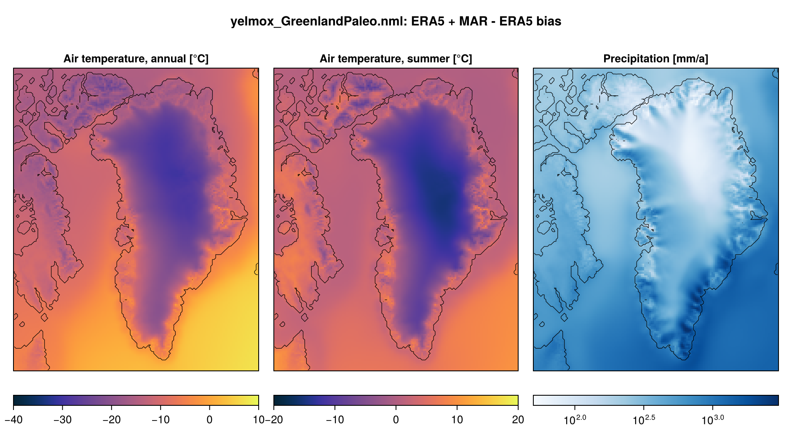
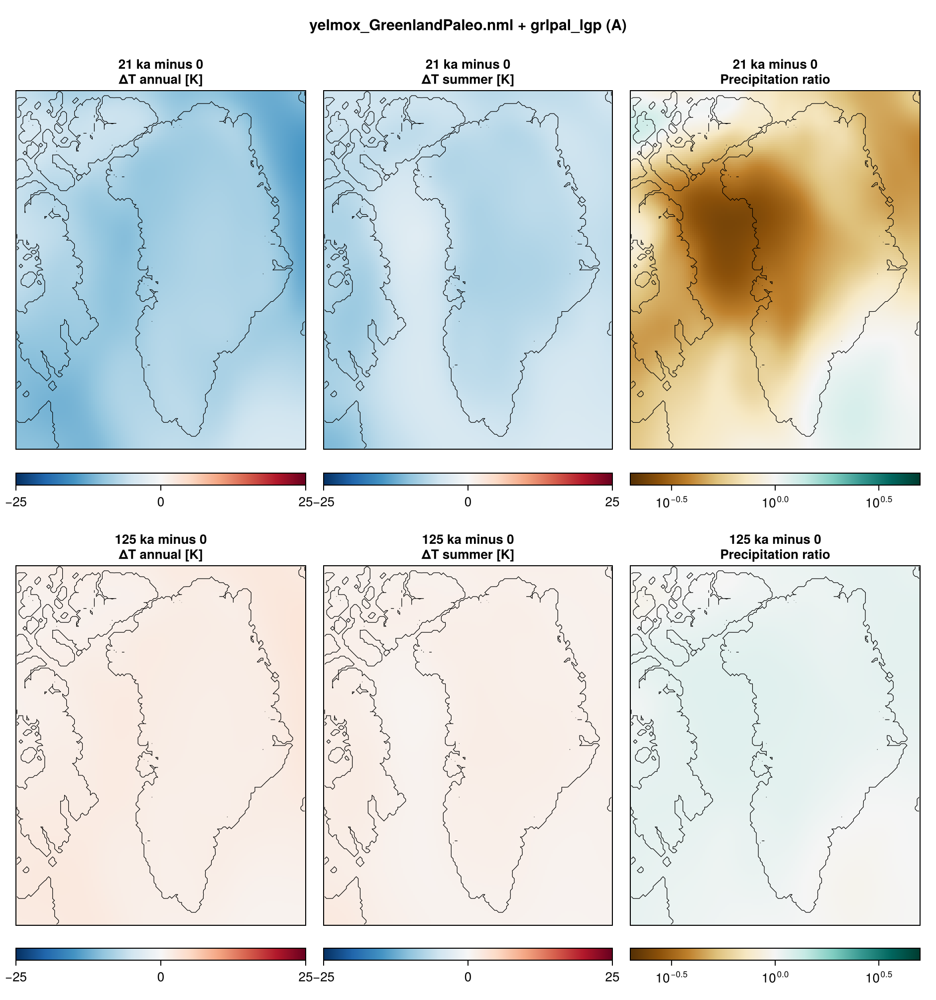
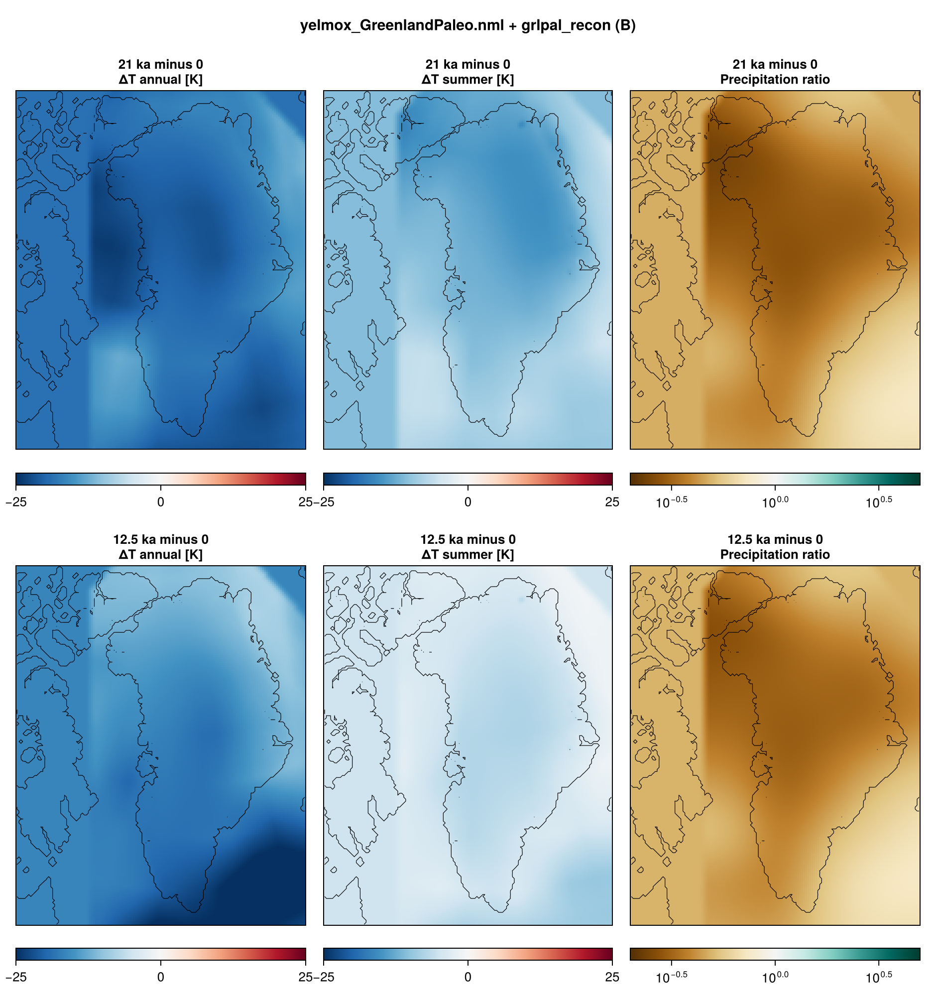

Greenland paleo simulations on the GreenlandPaleo domain (GRL-PAL, 16 km), the
Greenland domain extended 640 km to the west (Ellesmere, Devon Island, Baffin
Bay). Two setups, without optimization of the basal friction or the ocean
thermal forcing:

- **A. Last glacial period**, as the [Antarctic paleo](experiment-ant-paleo.md):
  a 15-kyr present-day **spin-up**, then a **transient** from 130 kyr ago to the
  present, restarted from the spin-up, with the climate scaled by a glacial index.
- **B. Deglaciation** after Tabone et al. (2024): an **LGM spin-up** from GLAC-1D,
  then a **transient** from 21 ka to the present forced by the Greenland
  climate reconstructions of Buizert et al. (2018, temperature) and Badgeley et
  al. (2020, precipitation).

- **Program:** `yelmox` (`make yelmox`) with the snapshot backend
  (`[comps] climate = "snapshots"`, see [Snapshots](climate-snapshots.md)).
- **Config:** `yelmox/yelmox_GreenlandPaleo.nml` (base); A:
  `yelmox/yelmox_GreenlandPaleo_spinup.nml`, `yelmox/yelmox_GreenlandPaleo_lgp.nml`;
  B: `yelmox/yelmox_GreenlandPaleo_lgm.nml`, `yelmox/yelmox_GreenlandPaleo_deglac.nml`.
- **Scripts:** `scripts/grl-paleo/`: A `run_spinup.sh`, `run_lgp.sh`; B
  `run_lgm_spinup.sh`, `run_deglac.sh`.
- **Design:** `docs/_grl-paleo-plan.md`.

## Running

Run from the yelmox root; each transient needs the last restart bundle of its
spin-up. A:

```bash
scripts/grl-paleo/run_spinup.sh
```

```bash
scripts/grl-paleo/run_lgp.sh
```

B:

```bash
scripts/grl-paleo/run_lgm_spinup.sh
```

```bash
scripts/grl-paleo/run_deglac.sh
```

`run_spinup.sh [output_path]` writes to `output/grl-paleo/spinup` by default,
`run_lgm_spinup.sh [output_path]` to `output/grl-paleo/lgm`.
`run_lgp.sh [spinup_path] [output_path]` restarts from
`<spinup_path>/restart-15.000-kyr` and writes to `output/grl-paleo/lgp`;
`run_deglac.sh [lgm_path] [output_path]` restarts from
`<lgm_path>/restart-20.000-kyr` and writes to `output/grl-paleo/deglac` (the
bundles are passed as absolute paths; the scripts stop if one is missing). All
submit to the `shared` queue (2 days, 10 GB, no OpenMP). On a busy cluster, run
them as chains of short jobs instead: [Long runs in chunks](run-chunks.md) has
the commands.

## Domain borders

The west border cuts Baffin Island and the Canadian Arctic Archipelago, where
Innuitian and Laurentide ice crosses it in glacial periods. The borders are
"infinite" (`[yelmo] experiment = "infinite"`, `mask_border = "dynamic"`): the
outermost cells take the thickness of their inner neighbours, so the border ice
thickens and thins with the interior. Ice flows out through the border but not
in (the outflow is booked in `mb_resid`): the ice west of the border is what the
local climate builds. Before Yelmo fixed this (2026-10-19), the border cells fed
the interior wherever the flow pointed inwards, without limit and unbooked; in
the first B LGM spin-up this inflow grew exponentially (above the domain SMB
after ~8 kyr) and piled ice up to 10 km at the front in northern Baffin Bay.

Prescribed border ice is the alternative (not used now): a
strip of fixed and relaxation cells (`[yelmo_masks] border_width = N M`, e.g.
`2 4`) whose thickness comes from an ice history (`[ice_bnd] active = True`,
PaleoMIST by default), with `experiment = "None"`, `mask_border = "auto"` and
`[ytopo] topo_rel = -1`.

## Reference climate

ERA5 1981--2010 (monthly) is the present-day reference on the whole domain; MAR
v3.14 covers only Greenland. Over Greenland, `[bias]` corrects ERA5 to MAR
1981--2010 with a monthly temperature difference `dtas` and precipitation factor
`fpr`, both taken at sea level with the reduction of the snapshot backend
(`[snap] lapse`, `f_p`), so they do not depend on elevation. Outside the MAR
coverage the correction is the nearest value of the bias smoothed over 50 km,
tapered to zero over 100 km (cosine). `fpr` is clamped to [0.2, 5].

The product is a hand-built file in ice_data,
`ice_data/GreenlandPaleo/GRL-PAL-16KM/GRL-PAL-16KM_BIAS-MARv3.14-ERA5-1981-2010.nc`
(`clim_db.nml` groups `bias_mar_era5_1981_2010_dtas`, `_fpr`), made by

```bash
julia --project=scripts/grl-paleo scripts/grl-paleo/make_bias_mar_era5.jl --fig
```

from the yelmox root (`fesmdata` and `ice_data` links in place; options `--res`,
`--l1`, `--l2`, `--f_p`, `--D`, `--sigma`, `--fpr_min`, `--fpr_max`). The lapse
rates and `f_p` are written as attributes: remake the file when `[snap] lapse` or
`f_p` change.



## A. Spin-up

- **Timeline:** `[ctrl]` 0 to 15 kyr, `dtt = 10` yr, present-day insolation
  (`[orbit] method = "time"`, `time = 0`), sea level from file at 0 ka.
- **No optimization** (`[sim] opt = False`); the ice thickness relaxes towards
  the observations until 6 kyr (`[sim] relax = True`, `[relax] time2`).
- **Climate:** present day (`[snap] snapshots = "pd"`) with the MAR -- ERA5 bias.
- **Output:** restart bundles at 0 and 15 kyr; 2D output every 1 kyr.

## A. Transient

- **Timeline:** `[ctrl]` -130 kyr to 0, `dtt = 10` yr, on relative time
  (`tstep_method = "rel"`). `[sim] relax = False`, `opt = False`.
- **Climate:** snapshots `pd`, `picontrol`, `lgm` and the axis `a`
  (`[snap_axis_a]`): the present-day reference plus the PMIP3 LGM -- piControl
  anomaly, scaled by the glacial index `[idx_a]`
  (`input/alpha_combined_125kyr_interp.dat`, as is: 0 = present day, ~0.9 at
  21 ka, -0.2 in the last interglacial). The ocean anomaly is `f_to = 0.25` times
  the mean sea-level air temperature anomaly (`[ocn_fraction]`). Insolation varies
  in time (`[orbit] method = "clock"`).
- **Sea level:** `[barysealevel] method = "file"`, `input/sealevel_spratt2016.dat`.



- **Ice age:** isochrones with elsa (`[ytrc] use_elsa`, `[elsa_grl_paleo]`): one
  layer every 1 kyr, coupled every 50 yr (for comparison with MacGregor et al., 2025).
- **Output:** 2D every 1 kyr, 1D every 100 yr, restart bundles every 25 kyr.

## B. Reconstruction forcing

Snapshots `pd`, `b18_base`, `b18`, `b20` and two axes at a constant index `one`
(`[idx_one]`, 1), each field bound to one axis:

- **Temperature**, axis `b18` (`[snap_field_tas] axes`): the Buizert et al.
  (2018) monthly reconstruction (`snap_b18`, decadal, 22 ka to 2005 CE) minus its
  1981--2010 baseline (`snap_b18_base`), both at the reconstruction's elevation.
- **Precipitation**, axis `b20` (`[snap_field_pr] axes`, `blend = "ratio"`): the
  Badgeley et al. (2020) fraction relative to 1850--2000 CE (`snap_b20`,
  `lo = ""`: the hi is the ratio itself; 50-yr means, 20 ka to 0; annual, the
  same factor in every month). `b20_pr_frac_low`/`_high` are the other
  accumulation scenarios.

Swapping the axes of the two fields gives the other combinations (Badgeley
temperature: its annual anomaly in every month). The time-varying groups are
read in time on the forcing clock (`extrap`: the first slice before the
record starts, e.g. Badgeley at 20 ka during the LGM spin-up).

The reconstructions are GRL-16KM products, remapped online onto GRL-PAL and
filled from the nearest cell outside the GRL box. `[taper]` with `outside =
"mean"` replaces the anomaly there by the mean anomaly of the coverage (per
month: the temperature difference and the precipitation ratio of the totals,
recomputed at every climate update): `w = 1` in the coverage of both, a
cosine to 0 over 100 km (hand-built file
`ice_data/GreenlandPaleo/GRL-PAL-16KM/GRL-PAL-16KM_TAPER-Buizert2018-Badgeley2020.nc`,
`clim_db.nml` group `taper_b18_b20`, made by
`scripts/grl-paleo/make_taper_recon.jl`). West of it (Ellesmere, Baffin Bay)
the climate is the present-day reference plus that mean anomaly.

The ocean anomaly is `f_to = 0.25` times the mean sea-level air temperature
anomaly (`[ocn_fraction]`); sea level from `input/sealevel_spratt2016.dat`
(as A); insolation at the forcing clock (`[orbit] method = "clock"`). The
climate is updated every 100 yr (`dt_clim`; the reconstructions are read and
remapped from GRL-16KM at each update, which made 10 yr six times slower).



## B. LGM spin-up

- **Timeline:** `[ctrl]` 0 to 20 kyr, the forcing held at 21 ka
  (`tstep_method = "const"`, `tstep_const = -21e3`): reconstructions, insolation
  and sea level of 21 ka.
- **Initial ice:** GLAC-1D at 21 ka on the whole domain (`[sim] init_method =
  "recon"`, `recon_time = -21e3`, `recon_regions = "all"`), cold start.
- **Output:** restart bundles at 0 and 20 kyr; 2D output every 1 kyr.

## B. Transient

- **Timeline:** `[ctrl]` -21 ka to 0, on relative time, restarted from the LGM
  spin-up.
- **Ice age:** isochrones with elsa (`[elsa_grl_paleo]`): one layer every 500 yr.
- **Output:** 2D every 500 yr, 1D every 10 yr, restart bundles every 7 kyr.

## Configuration common to all

| | |
|---|---|
| Grids | `GRL-PAL-16KM` for every component |
| Topography | BedMachine v6 (`GRL-PAL-16KM_TOPO-BedMachine-v6.nc`) |
| Reference climate (`snap_pd`) | ERA5 1981--2010 + MAR -- ERA5 bias over Greenland (`[bias]`); ocean ORAS5 1981--2010 |
| Snapshots (`snap_picontrol`, `snap_lgm`) | PMIP3 piControl and LGM ensemble means, global (`GLOBAL-1DEG`, remapped, 50 km smoothing; atmosphere only, the ocean follows `[ocn_fraction]`) |
| Surface mass balance | chion (`[comps] surface_method = "chion"`) |
| Shelf melt | `bmb_method = "lin"`, `tf_method = 1` |
| Dynamics | DIVA, `nz_aa = 10`, `grad_lim = 0.1` |
| Basal friction | no optimization; `cb_ref` scaled linearly with bed elevation (`[ytill] scale_zb = 1`, `cf_ref = 0.5` above 300 m, `cf_min = 1e-3` below -500 m); `till_delta = 0.1`, `bkt_till_rate = 1e-3` |
| Calving | level set, von Mises (`calv_flt_method = calv_grnd_method = "vm-m16"`) |
| Frontal melt | proportional to the shelf melt (`fmb_method = 1`) |
| Deep ocean | `c_deep = -10` m/yr below 2000 m in the open ocean (`mask_deep_ocean = "zone:open_ocean"`) |
| Geothermal heat flux | Fox Maule et al. (2005) (`[ghf] use_obs = True`) |
| Sea level | Spratt and Lisiecki (2016), short stack, its +8.5 m at 0 ka removed linearly over 0-10 ka (`input/sealevel_spratt2016.dat`, made by `scripts/grl-paleo/make_sealevel_spratt2016.jl` from FesmData SeaLevel-Spratt2016): -120 m at 21 ka, -130 m at 24 ka (A and B) |
| Isostasy | FastIsostasy LV-ELVA, two uniform mantle layers (88 and 600 km, 1e21 and 2e21 Pa s, as ISMIP7 GRL; the GRL-PAL Lloyd2024 file does not have the layout of `rheology_file`) |
| Borders | "infinite" (see above) |
