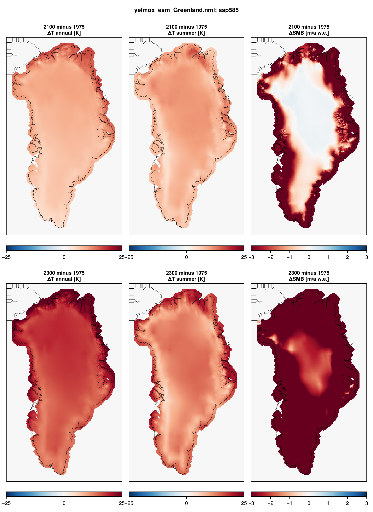
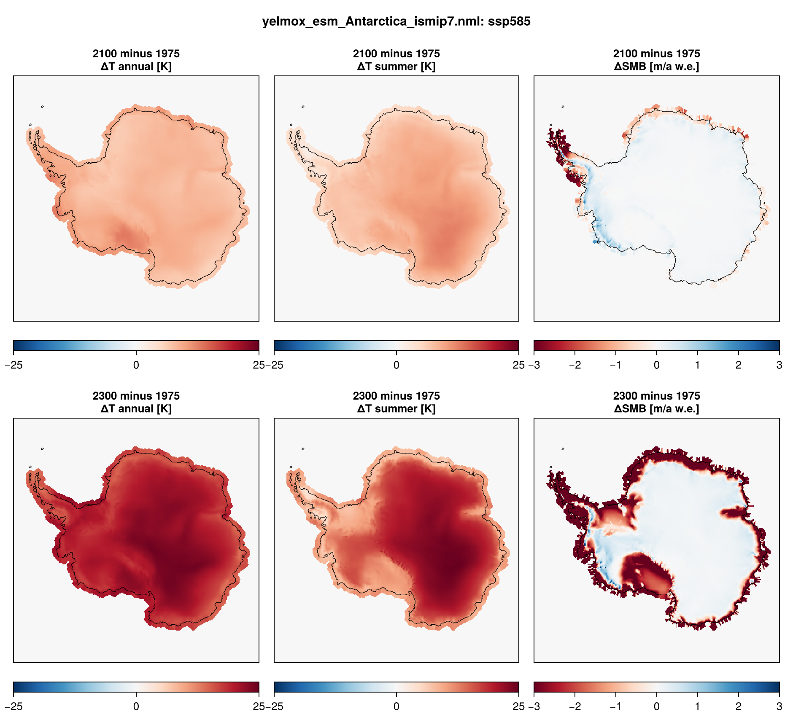

Greenland and Antarctic projections for ISMIP7 run in two steps: a present-day
**optimization spin-up**, which fits the basal friction (`cb_ref`) and an ocean
thermal-forcing correction (`tf_corr`) to the observed ice thickness and writes a
restart bundle, then the **scenarios**, which start from that bundle in 2015 and
run under the ESM forcing (historical + projection) to 2300.

- **Program:** `yelmox` (`make yelmox`) with the ESM climate backend
  (`[comps] climate = "esm"`, see [ESM forcing](climate-esm.md)).
- **Config:** `yelmox/yelmox_esm_Greenland.nml`, `yelmox/yelmox_esm_Antarctica.nml`
  (the ISMIP7 setup: `-p`).
- **Forcing data:** `input/esm/esm_grl_ismip7.nml`, `input/esm/esm_ant_ismip7.nml`
  (see [Database namelists](database-namelists.md)).
- **Scripts:** `scripts/ismip7/` -- workflows `run_ismip7_greenland.sh`,
  `run_ismip7_antarctica.sh`; tuned spin-ups `opt_grl.sh`, `opt_grl_ismip.sh`,
  `opt_grl_k24.sh`, `opt_ant.sh`. The Antarctic ISMIP7 setup is
  `scripts/ismip7/params.sh` (`ismip7_ant`).

The par files on their own (Antarctica: with `ismip7_ant`) run the
optimization spin-up without relaxation
(`[ctrl] run_step = "spinup"`, `[sim] opt = True`, `relax = False`, `[spinup]
time_end` = 15 kyr for Greenland, 20 kyr for Antarctica); the scripts set the
run phase, the relaxation and the run length. [1pctCO2](experiment-1pctco2.md)
and [TIPMIP](experiment-tipmip.md) follow the same two-step workflow.

## Running the workflow

Run from the yelmox root, one step after the other: the scenarios read the
spin-up's last restart bundle.

```bash
scripts/ismip7/run_ismip7_greenland.sh spinup
```

```bash
scripts/ismip7/run_ismip7_greenland.sh scenarios
```

`STAGE=1` creates the run folders and the SLURM script without submitting them
(a dry run). The settings are at the top of each script:

| Setting | Greenland | Antarctica | |
|---|---|---|---|
| `GRID` | `GRL-8KM` | `ANT-16KM` | `[domain] grid_hub` |
| `GCM` | `CESM2-WACCM` | `CESM2-WACCM` | `[esm] esm_name` |
| `SCENARIOS` | `ssp126 ssp370 ssp585` | `ssp585` | `[esm] experiment` |
| `SPINUP_YEARS` | 15000 | 20000 | `[spinup] time_end`, matches `[opt] cf/tf_time_end` |
| `PROJ_END` | 2300 | 2300 | `[transient] time_end` |
| `OUTROOT` | `output/ismip7_grl` | `output/ismip7_ant` | spin-up in `spinup/`, scenarios in `<ssp>/` |

The spin-up passes `ctrl.run_step=spinup comps.dt_clim=10 sim.relax=True
sim.opt=True`; each scenario passes `ctrl.run_step=transient`,
`esm.experiment=<ssp>`, `esm.esm_name=<GCM>`, `esm.use_esm/use_hist/use_proj=True`
and `ctrl.restart` = the bundle `<OUTROOT>/spinup/restart-<SPINUP_YEARS/1e3>-kyr`
as an absolute path (the run starts inside its own folder).

**Other grids.** The full input set exists for `GRL-8KM`, `GRL-16KM` and
`ANT-8KM`, `ANT-16KM`, `ANT-32KM` (GRL-4KM: inputs present since 2026-10, not yet
tested). The Antarctic Earth structure follows the grid: `[isos]
rheology_file = ".../{grid_name}_GIA_HR24.nc"`, `{grid_name}` = `grid_isos`.

**Short spin-ups.** The spin-up relaxes the ice thickness towards the
observations at first (`[relax] tau1/2`, until `time2`: 6 kyr for
Greenland). A spin-up that ends before then hands the scenarios ice that the
relaxation was holding in place, e.g. thin margin ice under negative SMB, which
is then lost within the first years.

## Tuned spin-ups

`opt_grl.sh`, `opt_grl_ismip.sh` (L. Gutierrez Gonzalez) and `opt_ant.sh` are
15-kyr optimization spin-ups with tuned parameters on top of the par files:
`cb_ref` started from
the till friction of the bed (`opt.cf_init=-1`, the `ytill` parameters), a short
relaxation (`relax.time1/2 = 100`), equilibrium calving, DIVA dynamics and
shelf enhancement 0.5; `opt_grl_ismip.sh` uses von Mises calving (`vm-l19`) and a
linear melt law. To run the scenarios from one of them, set `BUNDLE` in the
workflow script to its last restart bundle.

## Greenland with K24 hydrology

`opt_grl_k24.sh` is `opt_grl.sh` with the K24 subglacial hydrology of
FastHydrology, its array `k24_params` on `yelmox_esm_Greenland.nml`:
`[yhyd] method_transport = 1`, so K24 sets the effective pressure `N_eff` (the
bucket closure `bkt_N_closure` is not used), with `k24_sliding_law = 4` (the
frictional heat of Yelmo's basal stress enters the K24 water source) and
`k24_N_ub_coupled = True` (`N_eff` re-evaluated from the basal velocity inside
the DIVA iteration). The physical water viscosity `k24_water_viscosity =
1.8e-3` Pa s is the base's. Output in `output/ismip7/GRL-8KM/opt-l21-grimp-k24`:

```bash
scripts/ismip7/opt_grl_k24.sh
```

`run_ismip7_greenland.sh` reads `yelmox_esm_Greenland.nml`; there is no K24
workflow script.

## Forcing

The atmosphere and ocean are a reference climatology plus ESM anomalies relative
to `time_esm_ref` (1960--1989), applied over `time_hist` (1850--2014) and
`time_proj` (2015--2300). The spin-up (`run_step = "spinup"`, `[esm] experiment
= "ctrl"`) applies the reference climatology only; the ESM fields are read in
the scenarios (`run_step = "transient"`, `use_esm = True`).

| | Greenland | Antarctica |
|---|---|---|
| Reference atmosphere | MAR v3.14, monthly climatology 1961--1990, FesmData v2 `SMB-MARv3.14-1961-1990` | RACMO2.3p2 (ERA5), monthly climatology 1985--2014 (`time_ref`), FesmData v2 `SMB-RACMO2.3p2-1985-2014` |
| Reference ocean | ORAS5, mean of the monthly climatology 1981--2010, FesmData v2 `Ocean-ORAS5-1981-2010` (read on GRL-16KM, remapped onto the run grid, gaps filled) | meltMIP observational climatology (extrapolated) |
| ESM atmosphere | ISMIP7 SDBN1 `tas`, `acabf`, `dacabfdz` (`pr` instead of `acabf`, `dacabfdz` with `surface_method = "chion"`) | same, `v2` |
| Surface mass balance | the ESM smb, reference + `acabf` anomaly + `dacabfdz` elevation correction (`[comps] surface_method = "climate"`) | same |
| ESM ocean | ISMIP7 `tf`, `so` (2D, monthly) | ISMIP7 `thetao`, `so` (3D, annual, `v3`; projection files to 2299) |
| Subglacial discharge | ISMIP7 `sgd` | -- |
| Shelf melt | `bmb_method = "anom"`, `tf_method = 2` | `bmb_method = "quad-nl"`, `tf_method = 1` |
| Topography, basins | ISMIP7 obs v1.3 (GrIMP surface) | ISMIP7 obs v1.1 (Bedmap3) |
| Present-day smb, `T_srf` (comparison) | FesmData v2 `SMB-MARv3.14-1961-1990-annual-mean` (`T_srf`: skin temperature) | FesmData v2 `SMB-RACMO2.3p2-1981-2010` (`T_srf`: skin temperature) |

ESMs and scenarios on Levante (`ice_data/ISMIP7/<domain>/<grid>/`):

| ESM | Greenland | Antarctica |
|---|---|---|
| CESM2-WACCM | ctrl, historical, ssp126, ssp370, ssp534-over, ssp585 | historical, ssp585 |
| MRI-ESM2-0 | historical, ssp126, ssp370, ssp585 | historical, ssp126, ssp370, ssp585 |

### Forcing figures





## Output

The shared per-module files (`yelmo.nc`, `yelmo_ts.nc`, `isos.nc`, `mshlf.nc`,
`htopo.nc`; Antarctica also `yelmo_ts_APIS/WAIS/EAIS.nc`) and the restart bundles
`restart-<kyr>-kyr/`. With the par-file timing, the scenarios write the 1D
output every year, the 2D output (`[tm_2D]`) and restart bundles at 2015 and
2300, and the reduced 2D output (`[tm_2Dsm]`) every 100 yr for Greenland. For
ISMIP7 submissions, `[output] write_cmip = True` writes `yelmo_cmip.nc` and
`yelmo_ts_cmip.nc` every `dt_cmip`; `write_clim = True` adds the ESM forcing
(`esm.nc`, `esm_ts.nc`), with the smb applied (`smb_ann`, `tsrf_ann`).
