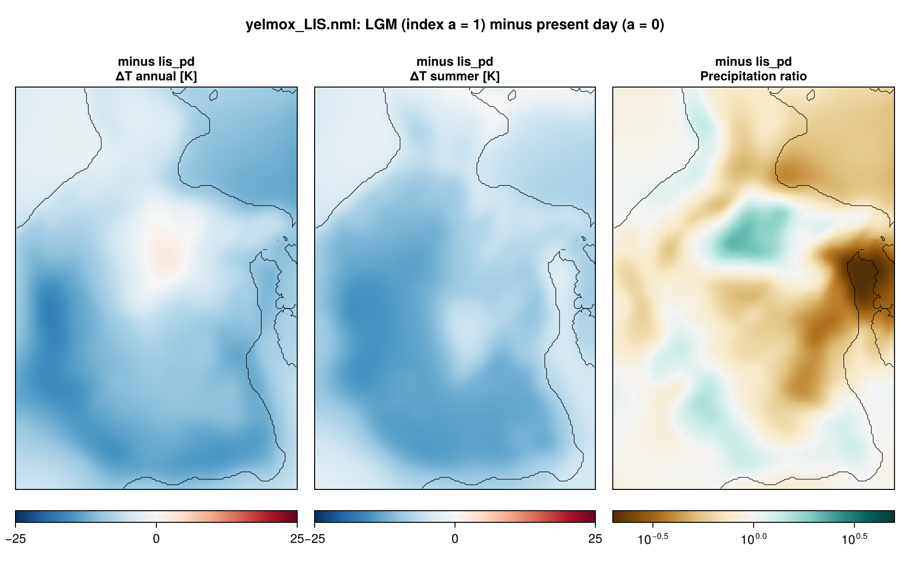
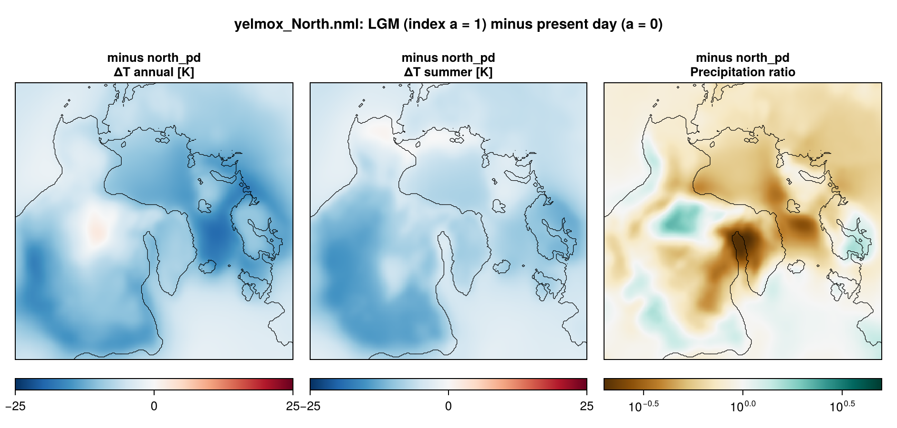

North American ice sheets in a steady Last Glacial Maximum climate, at 32 km, on
two domains: `Laurentide` (LIS-32KM) and the Northern Hemisphere `North`
(NH-32KM). Both start cold from the ICE-6G_C ice over North America and hold the
climate at the LGM position of a glacial index. They differ in the surface mass
balance: `smb_simple` on a target ice mask (Laurentide), chion PDD (North).

- **Program:** `yelmox` (`make yelmox`) with the snapshot backend
  (`[comps] climate = "snapshots"`, see [Snapshots](climate-snapshots.md)).
- **Config:** `yelmox/yelmox_LIS.nml`, `yelmox/yelmox_North.nml`.
- **Scripts:** `scripts/run_lis_smbsimple.sh` (Laurentide).

## Running

Run from the yelmox root. Laurentide, test runs and (optionally) ensembles:

```bash
scripts/run_lis_smbsimple.sh
```

```bash
RUN_ENSEMBLES=1 scripts/run_lis_smbsimple.sh
```

North:

```bash
runme -rs -q 12h -w 10:00:00 -e yelmox -n yelmox/yelmox_North.nml -o output/north
```

`run_lis_smbsimple.sh` submits two 30-kyr runs (`ctrl.time_end = 30e3`) to
`tmp/lischeck/<date>/`: `lgm-test` (`ctrl.tstep_const = -21e3`,
`smb_simple.mask_idx = 18`, the LGM mask) and `mis3-test` (`-35e3`,
`mask_idx = 16`, the 35 ka mask). `RUN_ENSEMBLES=1` adds `lgm-ens` and
`mis3-ens`, 9 members each: `ytill.cf_ref` = 0.05, 0.1, 0.2 times
`smb_simple.a1` = 3700, 3900, 4100 m (with `ytill.scale_zb = 2`, `z0 = -100`,
`z1 = 200`, `yhyd.till_delta = 0.1`). `RUNOPT` holds the runme options (default
`-rs -q 12h -w 10:00:00`); the North command uses the same.

## Timeline

- `[ctrl]` 0 to 50 kyr (Laurentide) or 100 kyr (North), `dtt = 10` yr, forcing
  time held at the LGM (`tstep_method = "const"`, `tstep_const = -21e3`);
  `[comps] dt_clim = dt_isos = 10` yr.
- Present-day orbit (`[orbit] method = "time"`, `time = 0`); sea level from the
  model's own ice (`[barysealevel] method = "fastiso"`).
- No relaxation or optimization (`[sim] relax = False`, `opt = False`).
- **Output:** 1D every 1 yr, small 2D every 50 yr, 2D every 5 kyr (Laurentide)
  or 200 yr (North), restart bundles every 20 kyr and at the end.

## Climate

The reference `pd` plus the term `lgm` (`[term_lgm]`, `picontrol`
-> `lgm` on `tas` and `pr`): ERA5 1981--2010 plus the PMIP3 LGM -- piControl
anomaly, additive for the temperature, as a ratio for the precipitation. The
PMIP3 snapshots are annual and JJA means (`monthly = False`), smoothed over
50 km (`clim_sigma`). The series is constant at the LGM (the par file
redefines `[series_alpha]` as `method = "const"`, `f_min = 1`), so the
climate does not depend on the forcing time. The ocean is ORAS5 1981--2010
plus the term `ocean`, 0.25 times the mean sea-level air temperature anomaly
over the domain (the derived series `dTo`, `region = "all"`).





## Initial state

Cold start (`[ctrl] restart = "None"`) from a reconstruction
(`[sim] init_method = "recon"`): the ice thickness `recon_var = "dz"` of
`recon_path = "ice_data/{domain}/{grid_name}/{grid_name}_TOPO-ICE-6G_C.nc"` at
the slice nearest to `recon_time = -26e3` (26 ka, the first slice), imposed
where `recon_regions = "region:North_America"` selects and the bed is above
-500 m. The imposed ice is smoothed (Gaussian, 2 dx), floating ice thinner than
50 m is removed, and the result becomes the reference thickness `H_ice_ref`;
the dynamics are then stabilized for 200 yr with `beta_min = 100` Pa a m-1
(`domain_init_recon`, `libs/kryos_startup.f90`). Elsewhere the ice is the
present-day ice of `[topo]`.

Where ice may grow (`[yelmo_masks] mask_ice_dynamic`): Laurentide excludes
Greenland (`"~region:Greenland"`) and has no ice on the domain border
(`[yelmo] mask_border = "none"`); North excludes the open ocean
(`"~zone:open_ocean"`), with the border of the `"auto"` default (no ice on the
border for the domain `North`).

## Surface mass balance

**Laurentide**, `[comps] surface_method = "smb_simple"`, synthetic-elevation
scheme (`[smb_simple] scheme = "syn"`, `libs/smb_simple.f90`). The SMB is
evaluated on a synthetic surface elevation built from the distance to the
margin of a target ice mask (plastic profile inside, `tau0 = 36` kPa):

    smb  = acc - abl,   acc = c0 exp(-d_in/L_acc),   abl = beta (z_SL - z)  (z < z_SL)
    z_SL = a1 + a2 phi,   beta = beta0 + beta1 (phiref - phi)

with `c0 = 300` mm w.e./yr, `L_acc = 300` km, `a1 = 3900` m, `a2 = -50` m/degN,
`beta0 = 5` (mm/yr)/m at `phiref = 60` degN, `beta1 = 0.05`. Outside the mask
the SMB is at most `smb_min = -2000` mm w.e./yr. The mask is
`ice_data/{domain}/{grid_name}/{grid_name}_Batchelor2019_ice_masks.nc` (`{grid_name}` = `grid_surface`: `LIS-32KM`), slice
`mask_idx = 18` (LGM; 14--17: 45, 40, 35, 30 ka). The climate enters only
through the sea-level air temperature: `t_srf = t_sl - gamma_t z_syn`
(`gamma_t = 6.5e-3` K/m), capped at 273.15 K inside the mask.

**North**, chion PDD (`[chion] model = "pdd"`, `[pdd_chion]`,
`pdd_method = "cg05"`), monthly temperature and precipitation of the climate;
`[surface_chion] time_equil = 100` yr of snowpack spin-up at the cold start.

## Configuration

| | Laurentide | North |
|---|---|---|
| Grids | `LIS-32KM` for every component (153 x 219) | `NH-32KM` for every component (276 x 276) |
| Topography | GEBCO 2026 (`TOPO-GEBCO2026`, FesmData) with `z_bed_sd` | GEBCO 2026, without `z_bed_sd` |
| Reference climate (`snapshot_pd`) | ERA5 1981--2010; ocean ORAS5 1981--2010 | same |
| Snapshots (`snapshot_picontrol`, `snapshot_lgm`) | PMIP3 ensemble means, global (`GLOBAL-1DEG`, remapped; atmosphere only) | same |
| Surface mass balance | `smb_simple`, Batchelor2019 LGM mask | chion PDD |
| Shelf melt | `bmb_method = "anom"`, `tf_method = 2` | same |
| Calving | `calv_flt_method = "vm-m16"`, level set | same |
| Dynamics | DIVA | DIVA |
| Basal friction | `cb_ref` from the bed elevation (`[ytill] method = 1`, `cf_ref = 0.1`), linear between `z0 = -500` and `z1 = 300` m | exponential between `z0 = -100` and `z1 = 100` m |
| Sediments | `SED-M23` (ice_data) | `Sediment-CRUST1` (FesmData) |
| Geothermal heat flux | `GHF-Shapiro2004` | same |
| Isostasy | FastIsostasy LV-ELVA, uniform mantle (1e21 Pa s), lithosphere thickness `LIS-32KM_GEO-P22.nc` | LV-ELVA, uniform mantle and lithosphere (88 km) |
| Named regions | `Hudson` (`region:Hudson_Bay_and_Strait`, `yelmo_ts_Hudson.nc`) | none |
