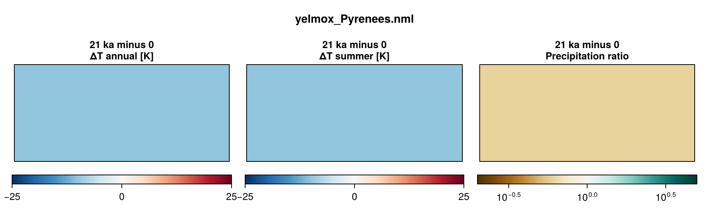
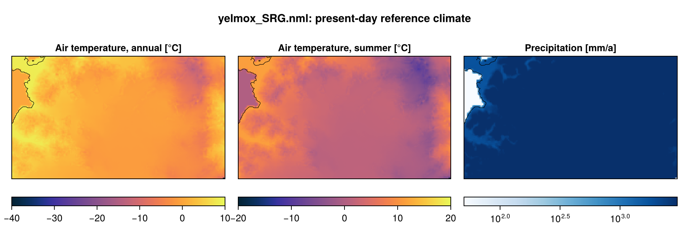

Two mountain-glacier domains with the ice sheet at 250 m and no ocean
(`[comps] with_shelf = False`): the **Pyrenees** over the last glacial cycle,
-120 kyr to the present, forced by a spatially homogeneous air-temperature
anomaly from an orbital index, and **SRG** (basin set `SanRafael`), 200 yr in
the present-day climate.

- **Program:** `yelmox` (`make yelmox`; formerly `make yelmox_glaciers`) with the
  snapshot backend (`[comps] climate = "snapshots"`, see
  [Snapshots](climate-snapshots.md)).
- **Config:** `yelmox/yelmox_Pyrenees.nml`, `yelmox/yelmox_SRG.nml`.

## Running

Run from the yelmox root; there are no scripts (queue, walltime and threads are
runme options).

```bash
runme -rs -q compute -w 08:00:00 --omp 16 -e yelmox -n yelmox/yelmox_Pyrenees.nml -o output/pyrenees
```

```bash
runme -rs -q compute -w 00:30:00 --omp 16 -e yelmox -n yelmox/yelmox_SRG.nml -o output/srg
```

## Grids

Each component runs on its own grid (`[domain]`, see
[Multigrid coupling](multigrid.md)):

| | Pyrenees | SRG |
|---|---|---|
| Hub, ice sheet, surface | `PYR-250M` (1520 x 688) | `SRG-250M` (208 x 120) |
| Climate | `PYR-2KM` (190 x 86), the grid of the FesmData ERA5 product | `SRG-250M` |
| Isostasy | `PYR-2KM` | `SRG-16KM` (off: `[comps] with_isostasy = False`) |

In the Pyrenees the climate is computed on the 2 km surface and moved to the
250 m surface for the surface model: monthly `tas` and `pr` interpolated
(bilinear) and corrected for the elevation difference with the lapse rates of
`[snapshots] lapse` and the precipitation scaling `f_p`. The geothermal heat flux is
read on `PYR-2KM` and remapped onto the Yelmo grid.

Settings that keep the 250 m runs cheap: 6 vertical levels in the ice
(`[yelmo] nz_aa = 6`), no level-set calving front (`[ycalv] use_lsf = False`),
the climate updated every 50 yr in the Pyrenees (`[comps] dt_clim = 50`; SRG
10 yr; the surface still runs every step), and the climate and isostasy of the
Pyrenees on 2 km.

## Pyrenees

- **Timeline:** `[ctrl]` -120 kyr to 0, `dtt = 10` yr, on relative time
  (`tstep_method = "rel"`); `[comps] dt_isos = 10` yr.
- **Initial state:** cold start from the present-day topography
  (`TOPO-GLO90-GEBCO2026`), a 10-yr equilibration with constant boundaries
  (`[sim] init_method = "equil"`, `init_equil_time = 10`).
- **Climate:** the reference (`snapshot_pd`, ERA5 1981--2010: `tas`, `pr`,
  `zs`) plus the term `uniform` (`[term_uniform]`, a uniform anomaly on `tas` and `pr`,
  `f_ta = -10` K) on the coefficient `alpha` (`[coef_alpha]
  method = "series"`, `input/alpha_orbital_t2018.dat`, 1 at present and 0 at
  21 ka, normalised with `norm_t0 = 0`, `norm_t1 = -21e3` to 0 at present and
  1 at 21 ka): `dTa = f_ta * alpha`, the precipitation times `exp(f_p dTa)`
  (`f_p = 0.05` K-1, the default). The air temperature is the ERA5 reference
  at present and 10 K below it at 21 ka (+1.4 to -11.1 K over the run). No
  ocean.
- **Orbit:** present day (`[orbit] method = "fixed_time"`, `time = 0`); the
  PDD takes no insolation.
- **Sea level:** the model's own ice (`[barysealevel] method = "fastiso"`).
- **Output:** 1D every 10 yr, 2D every 1 kyr, small 2D and restart bundles every
  10 kyr.

`[marine_shelf]` stays in the par file with the shelf off: the domain still
initializes the marine shelf (no data files are read).



## SRG

- **Timeline:** `[ctrl]` 0 to 200 yr, `dtt = 5` yr, constant forcing time
  (`tstep_method = "const"`). No coefficients or terms (`[forcing] coefs = ""`,
  `terms = ""`), present-day orbit and constant sea level (`[barysealevel]
  method = "const"`): the climate is the reference throughout.
- **Initial state:** present-day topography (`TOPO-GLO90-GEBCO2026`, with
  `z_bed_sd`), a 10-yr equilibration (`[sim] init_method = "equil"`).
- **Climate:** MAR v3.14 1960--1990 on `SRG-250M` (`[snapshot_pd]`), a legacy
  `ice_data` file not in FesmData; its database groups
  (`srg_mar314_1960_1990_tas`, `_pr`, `_zs`) are in the par file itself, which is
  searched before the `[forcing] var_defs` files. `[snapshots] f_p = 0.096` K-1.
- **Relaxation outside the icefield:** `[yelmo_masks] relax = "~SanRafael:1"`,
  `relax_tau = 50` yr, with `[ytopo] topo_rel = -1`: outside basin 1 of the
  `SanRafael` set the ice relaxes to the reference thickness; inside it evolves
  freely. `[sim] relax` and `opt` are off (`[relax]`, `[opt]` unused).
- **Output:** 1D every 1 yr, small 2D every 10 yr, 2D every 200 yr, a restart
  bundle at the end.



## Configuration

| | Pyrenees | SRG |
|---|---|---|
| Topography | GLO90 + GEBCO 2026 (`TOPO-GLO90-GEBCO2026`, FesmData) | same, with `z_bed_sd` |
| Reference climate (`snapshot_pd`) | ERA5 1981--2010 (`PYR-2KM`) | MAR v3.14 1960--1990 (`SRG-250M`, ice_data) |
| Surface mass balance | chion PDD (`[chion] model = "pdd"`, `[pdd_chion] pdd_method = "cg05"`), `time_equil = 10` yr | chion ITM (`[chion] model = "itm"`, smbpal's `[itm]`), `sigma_pdd = 8.27` K, `time_equil = 100` yr |
| Ocean, shelf melt | off | off |
| Calving | none (`calv_flt_method = "zero"`) | `calv_flt_method = "vm-l19"` |
| Dynamics | DIVA, `ssa_lat_bc = "all"` | DIVA, `ssa_lat_bc = "all"` |
| Basal friction | till angle (`[ytill] is_angle = True`), `cf_ref = cf_min = 30` deg | `cf_ref = 1.002`, `cf_min = 0.01`, linear between `z0 = -300` and `z1 = 200` m |
| Enhancement | 1 | `enh_shear = 3.093`, `enh_shlf = 0.7` |
| Slope limits | `[ytopo] grad_lim = grad_lim_zb = 1.0` | 0.5 |
| Isostasy | FastIsostasy LV-ELVA, uniform mantle and lithosphere | off |
| Geothermal heat flux | `GHF-Lucazeau2019` (`PYR-2KM`) | constant 50 mW m-2 (`[ghf] use_obs = False`) |
| Sediments | none (`[sed] method = 0`) | none |
