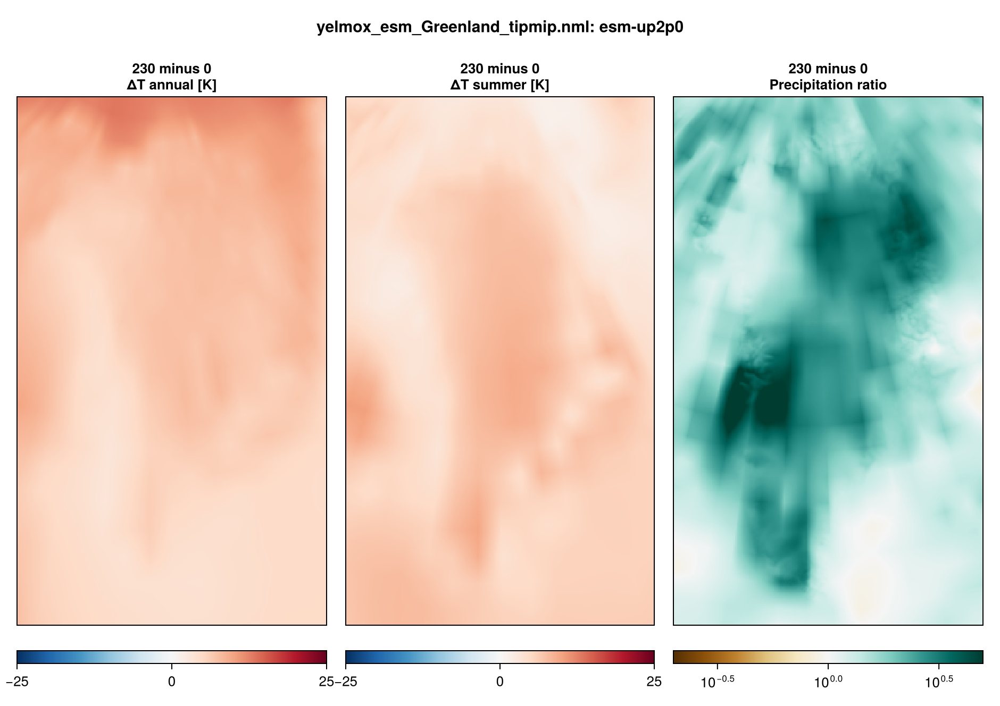

Greenland simulations for TIPMIP, in three steps: a present-day **optimization
spin-up**, as for [ISMIP7](experiment-ismip7.md); the **ramp** esm-up2p0
(232 yr), which starts from the spin-up's restart bundle; and the
**stabilisations** esm-up2p0-gwl2p0 and esm-up2p0-gwl4p0 (50 yr each), which
start from the ramp's restart bundles at the years where their forcing branches
off. The forcing is the TIPMIP anomalies relative to the GCM's piControl, added
to the present-day reference climatology.

- **Program:** `yelmox` (`make yelmox`) with the ESM climate backend
  (`[comps] climate = "esm"`, see [ESM forcing](climate-esm.md)).
- **Config:** `yelmox/yelmox_esm_Greenland.nml` (the TIPMIP setup: `-p`).
- **Forcing data:** `input/esm/esm_grl_tipmip.nml` (ramp),
  `input/esm/esm_grl_tipmip_gwl.nml` (stabilisations)
  (see [Database namelists](database-namelists.md)).
- **Scripts:** `scripts/tipmip/run_tipmip_greenland.sh`, with the setup
  `scripts/tipmip/params.sh` (`tipmip_grl`).

## Running

Run from the yelmox root, one step after the other: each step reads the restart
bundles of the previous one.

```bash
scripts/tipmip/run_tipmip_greenland.sh spinup
```

```bash
scripts/tipmip/run_tipmip_greenland.sh ramp
```

```bash
scripts/tipmip/run_tipmip_greenland.sh stabilisations
```

`MODEL` selects the GCM and grid; `STAGE=1` creates the run folders and the
SLURM script without submitting them.

| `MODEL` | `[esm] esm_name` | `[domain] grid_hub` | Steps | `OUTROOT` |
|---|---|---|---|---|
| `ipsl` (default) | `IPSL-CM6-ESMCO2` | `GRL-8KM` | spin-up, ramp, both stabilisations | `output/tipmip_grl_ipsl` |
| `ecearth` | `EC-Earth3-ESM-1` | `GRL-4KM` | spin-up, ramp | `output/tipmip_grl_ecearth` |

The runs are written to `<OUTROOT>/spinup`, `<OUTROOT>/esm-up2p0` and
`<OUTROOT>/esm-up2p0-gwl2p0`, `<OUTROOT>/esm-up2p0-gwl4p0`.

## Spin-up

15 kyr (`SPINUP_YEARS`), with `ctrl.run_step=spinup comps.dt_clim=10
sim.relax=True sim.opt=True esm.experiment=ctrl`. It is the Greenland ISMIP7
spin-up (same `[spinup]`, `[relax]` and `[opt]` groups) except for the surface
mass balance, which chion computes from the reference climate (`[comps]
surface_method = "chion"`). In the spin-up the backend applies the reference
climatology only.

## Ramp

- **Timeline:** `[transient]` years 0 to 232 after the piControl branch
  (`tstep_method = "cal"`, `dtt = 1` yr), restarted from
  `<OUTROOT>/spinup/restart-15.000-kyr`.
- **Switches:** `ctrl.run_step=transient esm.experiment=esm-up2p0
  esm.par_file=input/esm/esm_grl_tipmip.nml esm.use_esm=True esm.use_hist=False
  esm.use_proj=True`.
- **Periods:** `time_esm_ref = 0, 2`, `time_proj = 0, 231`; `time_hist = -1, -1`
  lies before `time_init`, so every step reads the projection.
- **Restarts:** for `ipsl`, the script sets `[tm_rst] method = "times"` with the
  branch years of the stabilisations, 109 and 232 (the end).

## Stabilisations

`esm-up2p0-gwl2p0` starts from the ramp bundle `restart-0.109-kyr`,
`esm-up2p0-gwl4p0` from `restart-0.232-kyr`. Both run years 0 to 50
(`transient.time_init=0 transient.time_end=50`) with
`esm.par_file=input/esm/esm_grl_tipmip_gwl.nml`. The stabilisation files start
warm; their `gcm_*_esm_ref` groups therefore read the ramp file (esm-up2p0,
years 0--2), so the anomalies stay relative to the piControl branch point, as
in the ramp. The projection groups read the 50-yr files of the experiment
(`time = 1, 0, 49, 1, 12`).

## Forcing

TIPMIP provides monthly anomalies relative to piControl, on the run grid:
`ice_data/TIPMIP/{domain}/{grid_name}/{gcm}/{experiment}/{grid_name}_{gcm}_{experiment}_*yrs_<var>.nc`.
The `gcm_*_esm_ref` and `gcm_*_proj` groups point at the same files, so with
`time_esm_ref = 0, 2` (anomaly about 0, ratio about 1) the backend recovers the
anomalies themselves.

| | |
|---|---|
| Reference atmosphere | MAR v3.14, monthly climatology 1961--1990 (`time_ref`), FesmData v2 `SMB-MARv3.14-1961-1990` |
| Reference ocean | ORAS5, 1981--2010, read on GRL-16KM and remapped (`bilin`, gaps filled) |
| Air temperature | `tas_anomaly` [K] |
| Precipitation | `pr_ratio` [1] |
| Ocean | `TF_anomaly` [K], thermal-forcing anomaly, averaged to annual and taken at the shelf base |
| Salinity | none: the `so` groups read the ORAS5 reference, `dso = 0` |
| Subglacial discharge | none (`[gcm_sgd_*] filename = "none"`, `Qd = 0`) |
| Surface mass balance | chion |
| Shelf melt | `bmb_method = "anom"`, `tf_method = 2` (the melt follows `dT_shlf`, the ocean anomaly) |
| Topography, basins | ISMIP7 obs v1.3 (GrIMP surface) |



## Output

The shared per-module files (`yelmo.nc`, `yelmo_ts.nc`, `isos.nc`, `mshlf.nc`,
`chion.nc`, `htopo.nc`) and the restart bundles `restart-<kyr>-kyr/`. With the
par-file timing, the ramp and the stabilisations write the 1D output every
year and the 2D output (`[tm_2D]`) at the start and the end.
`[output] write_clim = True` adds `esm.nc` and `esm_ts.nc`.
