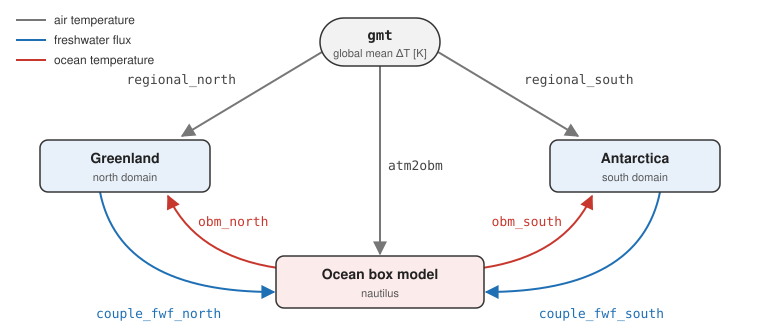

The two-domain variant of [`yelmox`](yelmox.md): it runs a northern and a southern
ice-sheet domain together, coupled through a **shared barystatic sea level** and a **shared Ocean
Box Model (OBM)** that exchanges freshwater flux and ocean temperature between the
hemispheres. Each domain is a full `kryos_domain`, configured
as in `yelmox` with the hemisphere suffix on its groups (see
[Configuration](yelmox.md#configuration)); the driver interleaves the `step_*` primitives
across both domains plus the OBM.

- **Program:** `yelmox_bipolar/yelmox_bipolar.f90` + `yelmox_bipolar/obm_coupling.f90` + `libs/kryos*.f90`.
- **Build:** `make yelmox_bipolar` (links the OBM stack, `$(obm_libs)`).
- **Config:** `yelmox_bipolar/yelmox_bipolar_Bipolar.nml`: north = Greenland
  (hub and ice `GRL-16KM`, the other components `GRL-32KM`), south = Antarctica
  (hub and shelf `ANT-16KM`, the other components `ANT-32KM`, with `relax` and
  `opt`); `[ctrl]` 0 to 40 yr, `dtt = 10` yr; uncoupled (the box model off).
  `[ctrl]`, `[barysealevel]` and the Yelmo physics groups (`ydyn`, `ytopo`, ...)
  are shared (no suffix).
- **Coupling setups:** `yelmox_bipolar/params.sh`, one runme `-p` array per
  setup ([below](#coupling-setups)).
- **Tests:** `yelmox_bipolar/run_tests.sh` runs every setup of `params.sh`
  (local runs under `tmp/bipolar-tests/`), or those named. `run_tests.sh
  forcing` runs the forcing tests: the setups of `bip_forcing_setups` with the
  ice sheets frozen and `gmt` a ramp (`bip_forcing`), each checked by
  `check_forcing.jl` (Julia, environment `yelmox_bipolar/`): `gmt` and its
  scaled coefficients in `forcing_ts.nc`, each domain's terms, air
  temperature, precipitation and ocean in `snap.nc`, the box air temperatures,
  vapour fluxes and `obm_north/south`; the last setup also restarted at 50
  years and compared with its continuous run.

## Coupling setups {#coupling-setups}

One global coefficient, `gmt` (global mean air temperature anomaly [K], `const`
0 in the par file), drives both ice sheets and the box model, through its
regional amplifications: the scaled coefficients `dTa_north` = 1.07 × `gmt`,
`dTa_tropics` = 0.79 × `gmt` and `dTa_south` = 0.86 × `gmt` of the library
(Zickfeld et al., 2004). A region's ice sheet and its box read the same
coefficient, so the amplification is set once, in its `factor`. Three
exchanges with the box model can be switched on, each on its own:

{width=100%}

| Exchange | Switched by | What it does |
|---|---|---|
| `gmt` → ice sheets | the terms `regional_north`, `regional_south` (in every setup) | the uniform anomaly `dTa_north` (`dTa_south`) on `tas` and `pr` |
| `gmt` → box model | `[ctrl] atm2obm` | the box air temperatures θ_i = θ_i,init + `dTa_i` (north, tropics, south) and the vapour fluxes from `gmt` (`[obm_forcing]`) |
| ice sheet → box model | `[ctrl] couple_fwf_north`, `couple_fwf_south` | the freshwater flux of the domain, within its hydrographic mask, into its box (`fn`, `fs`) |
| box model → ice sheet | the term `obm_north` / `obm_south` of the domain, its coefficient in `[forcing] coefs` | the ocean temperature `to` of the domain = its box temperature at every depth, read by the marine shelf |

Every exchange with the box model needs `[ctrl] active_obm = True`. The box
model does not act on the atmosphere: the surface mass balance of both ice
sheets sees `gmt` only.

The setups, each a `-p` array of `yelmox_bipolar/params.sh` on the par file
(`[ctrl]` keys = True unless noted):

| # | Setup | Array | `[ctrl]` | `forcing.coefs` | `forcing_north.terms` | `forcing_south.terms` |
|---|---|---|---|---|---|---|
| 1 | Uncoupled (the par file) | `bip_uncoupled` | – | `gmt`, `dTa_north`, `dTa_south`, `dTo` | `regional_north`, `ocean` | `regional_south` |
| 2 | Box model alone | `bip_obm_only` | `active_north` = `active_south` = False, `active_obm`, `atm2obm` | `gmt`, `dTa_north`, `dTa_tropics`, `dTa_south` | – | – |
| 3 | Box model → both ice sheets | `bip_obm_to_ice` | `active_obm`, `atm2obm` | `gmt`, `dTa_north`, `dTa_tropics`, `dTa_south`, `obm_north`, `obm_south` | `regional_north`, `obm_north` | `regional_south`, `obm_south` |
| 4 | Greenland → box model | `bip_gis_to_obm` | `active_south` = False, `active_obm`, `atm2obm`, `couple_fwf_north` | `gmt`, `dTa_north`, `dTa_tropics`, `dTa_south`, `dTo` | `regional_north`, `ocean` | – |
| 5 | Greenland ↔ box model | `bip_gis_obm` | `active_south` = False, `active_obm`, `atm2obm`, `couple_fwf_north` | `gmt`, `dTa_north`, `dTa_tropics`, `dTa_south`, `obm_north` | `regional_north`, `obm_north` | – |
| 6 | Antarctica ↔ box model | `bip_ais_obm` | `active_north` = False, `active_obm`, `atm2obm`, `couple_fwf_south` | `gmt`, `dTa_north`, `dTa_tropics`, `dTa_south`, `obm_south` | – | `regional_south`, `obm_south` |
| 7 | Greenland ↔ box model ↔ Antarctica | `bip_full` | `active_obm`, `atm2obm`, `couple_fwf_north`, `couple_fwf_south` | `gmt`, `dTa_north`, `dTa_tropics`, `dTa_south`, `obm_north`, `obm_south` | `regional_north`, `obm_north` | `regional_south`, `obm_south` |

Other combinations follow from these: e.g. `bip_full` without
`ctrl.couple_fwf_south=True` is Greenland ↔ box model → Antarctica. Run a
setup from the yelmox root:

```bash
source yelmox_bipolar/params.sh
runme -rs -e bipolar -n yelmox_bipolar/yelmox_bipolar_Bipolar.nml -o output/bip-full -p "${bip_full[@]}"
```

Further `-p` arguments go after the array (a later value wins). The rules
behind the table, checked at init (before the startup of the domains) where
noted:

- Every coefficient a term or `[obm_forcing]` uses is listed in `[forcing]
  coefs`, and only those (errors at init): with `atm2obm` all three `dTa_*`;
  without it no `dTa_tropics`, and no `dTa_*` of an inactive domain; no `dTo`
  once `obm_north` replaces `ocean`.
  `dTa_*` (scaled from `gmt`) and `obm_north`/`obm_south` (set by the box
  model each step) are library coefficients (`input/forcing_db.nml`).
- `obm_north` takes the place of `ocean`, never both: `obm_north` replaces `to`
  (`pattern = "replace"`) and `ocean` would add 0.25 × the air anomaly on top
  (an error at init: a domain with an ocean term on a box coefficient and one on
  an air-anomaly coefficient). Likewise `obm_south` in the south.
- A domain takes its ocean from the box of its own hemisphere: the north from
  `obm_north`, the south from `obm_south` (an error at init otherwise).
- With the box model on and an atmosphere that changes in time (a varying
  `gmt`), `atm2obm` is on too: the boxes would keep their initial air
  temperatures otherwise (an error at init).
- `couple_fwf_north`/`couple_fwf_south` need the box model and the domain of
  their hemisphere (errors at init), and the hydrographic masks `[ctrl]
  hydro_mask_north`/`hydro_mask_south` on the Yelmo grid of the domain
  (`{grid_name}_HYDRO-BASINS_zickfeld2004.nc`).
- A different amplification: a `[coef_dTa_north]` group in the par file with
  its own `factor` (both the domain and the box follow); a domain of its own
  amplification, unlike its box: an `f_ta` in its regional term on top.
- `dTo` (term `ocean`) is the mean air anomaly of the domain whose climate
  sets it, the north. The coefficients are shared, so a second domain with an
  ocean anomaly from its own air needs a coefficient of its own (a group
  `[coef_dTo_south]` as `[coef_dTo]`, and a term on it), not `dTo` (an error at
  init: an air-anomaly coefficient used by the terms of both domains).

Variations on a setup:

- **The box anomaly instead of the box temperature**: the reference ocean plus
  θ − θ_init of the box (`coef_obm_*.anomaly = True`, `term_obm_*.pattern =
  "uniform"`), with the modifier `bip_ocean_anomaly` after the setup: `-p
  "${bip_full[@]}" "${bip_ocean_anomaly[@]}"`.
- **A transient**: `gmt` from a time series, in `[coef_gmt]` of the par file
  (`method = "series"`, `series_file = ...`); see
  [Forcing](yelmox.md#forcing) for the coefficient methods.
- **A glacial pattern** (paleo): the library term `lgm` (PMIP3 LGM −
  piControl on the coefficient `alpha`) added to `[forcing_north] terms`, with
  `alpha` in `[forcing] coefs` (a `[coef_alpha]` group in the par file sets its
  record; the library default is `alpha_combined_125kyr_interp`). The box model
  does not see `alpha`: `gmt` stays its only forcing.
- **Hysteresis of the box model**: `[nautilus] hyster_on` (below).

## What's distinct

- **Two `kryos_domain`s** (`dom_north`, `dom_south`), each set up via
  `setup_domain`, then, after the consistency checks of the run
  (`obm_coupling_init`, `coefs_check_used`), started (`start_domain` →
  `domain_startup`). Either can be individually deactivated (`active_north` /
  `active_south`); with neither, the ocean box model runs alone (`active_obm`,
  forced by `atm2obm` or not; no freshwater flux, no terms on the box coefficients).
- **Shared `bsl`** — one barystatic sea level for the run, restored once at startup
  (`bsl_startup`) and written to the run restart bundle.
- **Shared forcing output** — `forcing_ts.nc` in the run folder, on the
  `[tm_1D]` cadence: every coefficient of `[forcing] coefs` under its name
  (`gmt`, `dTa_north`, ...) and `bsl`. What each domain's climate used is in
  its own climate file (`term_<name>` in `snap.nc`).
- **Shared OBM** (`obm`) — an ocean box model stepped once per timestep, configured
  via `obm_ctl_load` and coupled to the domains through `obm_coupling.f90`
  (`coupling_obm2ism`, `obm_coupling_init`, `obm_exchange`). The OBM writes its own
  1D output, `<obm_name>.nc` (`[ctrl] obm_name = "nautilus"`), on the
  `[tm_1D]` cadence; its restart (`obm_restart.nc`) goes into the run restart
  bundle next to `bsl_restart.nc`.
- **One restart bundle per run** — `restart-<kyr>-kyr/` holds the shared
  `bsl_restart.nc`, `obm_restart.nc` and the coefficients (`coef_<name>_restart.nc`),
  and each domain in a subfolder named after it (`Greenland/`, `Antarctica/`).
  `[ctrl] restart` is the bundle to start from. The output of each domain goes
  to the same subfolder of the run folder.

Climate/SMB per domain is **snapshots + chion** (`[chion_north] model = "itm"`,
`[chion_south] model = "pdd"`), as in the single-domain driver;
the OBM's contribution is folded into the ocean forcing — `obm_exchange` sets
the derived coefficients `obm_north`/`obm_south` (the box temperatures) and re-applies
each domain's ocean terms (e.g. the `replace` terms `term_obm_north`/`_south`:
the box temperature into `to_ann`) before the marine-shelf step reads it.

## Stepping order

Main loop (per timestep):

```fortran
call bsl_update(bsl, ts%time_rel)              ! shared sea level, once
call coefs_update(coefs, ts%time_rel, var=fvar) ! shared coefficients, once (fvar: ice volume of the active domains [Gt])

if (active_north) then                         ! relaxation + optimization + isostasy, per domain
    call step_relax(dom_north, ts)
    call step_optimize(dom_north, ts, dtt)
    call step_isostasy(dom_north, ts, bsl)
end if
(same for dom_south)

if (oc%active_obm) call obm_update(obox, real(dtt,wp), oc%obm_name)   ! ocean box model, one step

if (active_north) then                         ! ice sheet, hub, climate + smb, per domain
    call couple_to_yelmo(dom_north)
    call step_ice_bnd(dom_north, ts, coefs)
    call step_icesheet(dom_north, ts)
    call couple_yelmo_to_htopo(dom_north)
    call step_climate(dom_north, ts, dtt, coefs)
    call step_surface(dom_north, ts)
end if
(same for dom_south)

call obm_exchange(oc, obox, coefs, dom_north, dom_south, ...)  ! atm->obm, ism->obm freshwater,
                                                              ! hysteresis forcing, obm->ism (the obm_* coefficients, ocean terms)

if (active_north) call step_shelf(dom_north, ts)  ! reads the obm-updated to_ann
if (active_south) call step_shelf(dom_south, ts)
```

Key ordering points:

- **Isostasy for both domains runs before the OBM step**, so the OBM sees a
  consistent geometry.
- **`obm_update` uses the previous step's** atmospheric/freshwater forcing (a
  one-step lag), then `obm_exchange` distributes the fresh OBM state back to the
  domains before the marine-shelf melt is computed.
- The per-domain primitives are the same as in the single-domain `yelmox`; only
  the relaxation + optimization + isostasy part is split off so it runs before the OBM step.

## Forcing

The forcing of each domain is that of `yelmox` ([Forcing](yelmox.md#forcing)):
a reference snapshot plus terms, `[forcing_north]` and `[forcing_south]`. What
the bipolar driver adds:

- **Shared coefficients** (`[forcing] coefs`, `[coef_<name>]`): one registry
  for both domains and the OBM, advanced once per step, written to the run's
  `forcing_ts.nc`, restarted from the run bundle (`coef_<name>_restart.nc`),
  with the kill switch and `restart_every_df` bundles as in `yelmox`.
- **`atm2obm`** (`[ctrl]`): the box air temperatures from `[obm_forcing]`,
  `theta_i = theta_i_init + dT_i` for north, tropics and south (the
  coefficients `coef_north`, `coef_tropics`, `coef_south`: `dTa_north`,
  `dTa_tropics`, `dTa_south`, `gmt` amplified, Zickfeld et al., 2004) and the
  vapour fluxes `phin`, `phit` linear in the global anomaly (`coef`: `gmt`). It
  needs no ice-sheet domain; the coefficients must be in the registry
  (checked at init).
- **Box model → ice sheet** (obm2ism): per domain, a coefficient derived from
  the box (`[coef_obm_north]`, `[coef_obm_south]` of the library: `method =
  "derived"`, `from = "obm_north"`/`"obm_south"`, the box temperature, or its
  anomaly to the initial value with `anomaly = True`) with a term on `to`
  (`[term_obm_north]`/`[term_obm_south]`: `replace`, `to_ann` = the box
  temperature; `uniform` with the anomaly coefficient for the reference + the
  box anomaly). On when a term uses such a coefficient. `obm_exchange` sets the
  coefficients and re-applies the ocean terms after both climate steps. At the
  start the box model is initialized (cold start or restart) and the
  coefficients set before the domains, so their startup climate, shelf and ice
  state already see the box.
- **Freshwater flux** (`[ctrl] couple_fwf_north`/`couple_fwf_south`): the flux
  of each domain into its box (`fn`, `fs`), from the Yelmo mass balance
  (`fwf_definition`: `dVdt`, `mb`, `ablation`) within the hydrographic mask
  (`hydro_mask_north`/`hydro_mask_south`, on the Yelmo grid).
- **Hysteresis** (`nautilus` only): `[nautilus] hyster_on` nudges one box-model
  control (`hyster_forcing`: `phit`, `phin`, `fn`, `fs`, `global_melt`) along
  `hyster_forcing_method` (`triangular`, `sin`, `noise`, `linear`) in
  `obm_exchange`.

`obm_restart.nc` (run bundle) holds the box state, the fluxes and the box air
temperatures; the `*_init` values stay those of the par file, the reference of
`atm2obm` and of the box anomaly (`anomaly = True`).
